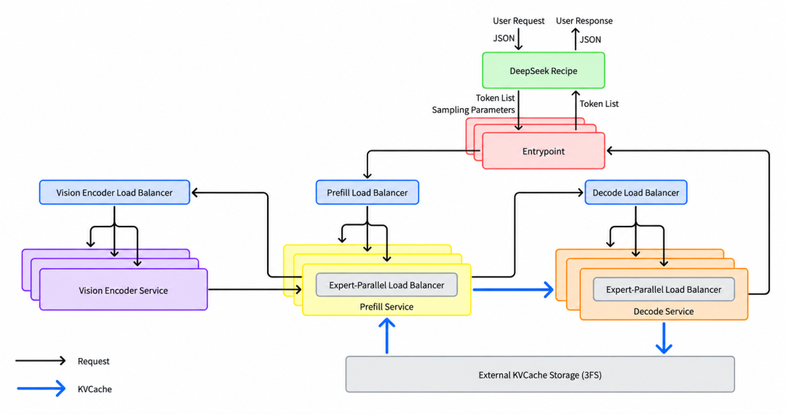

# DeepSeek 开源 DeepInfer：推理提速，为什么要从模型设计开始？

> 原文首发于微信公众号「Wenyan的呜哇」，2026-10-20。[阅读原文](https://mp.weixin.qq.com/s/qBMK-eT4uYaAXrhYQwvHVQ)

上一篇，我们从持续批处理、分块预填充，讲到计算阶段分离和全局缓存复用。这些方法解决的是同一个问题：大量请求同时到来时，怎样让 GPU 多做有效计算，又不让用户等得太久。

DeepSeek 开源的 DeepInfer，把这条线索继续向前推进了一步：模型的结构，也可以为推理系统创造优化空间。

例如，有些历史状态可以长期保存，避免重复计算；有些状态可以只保留很小一部分，缺失时再近似恢复；模型还可以额外预测草稿的可信程度，帮助系统决定把计算资源分配给谁。

这些设计，在 DeepSeek-V4.1-Flash 的推理系统里连成了一体。

官方部署文档给出了一组醒目的数字：单个集群每天服务 155 万亿 token，按 API 谷时价格口径，每 GPU·小时收入约 38 美元。不过，这份问答没有给出足以拆解这组总量的输入、输出及缓存命中 token 构成，也没有提供完整成本账。它们可以帮助理解服务规模，不能直接当作模型每秒生成多少新 token、单卡利润有多高的答案。

这篇文章重点看数字背后的机制：一次请求进入系统后，哪些计算可以省，哪些数据需要搬，哪些等待可以被消除。

> 阅读范围：依据截至 2026 年 10 月 20 日的 DeepInfer 与 deepseek-recipe 源码，以及仓库中的官方部署问答。源码用于核对实现机制；生产部署与性能数字转述自官方，本文未独立复现。固定版本与资料链接见文末。

## 01｜先分清：开源引擎与完整服务系统

这次发布涉及两个仓库。

DeepInfer负责模型推理，包括计算、调度、内存管理、投机解码和结构化输出。它最初主要基于 vLLM 构建，也借鉴了 SGLang 等项目的实现。

deepseek-recipe负责接口协议与模型 token 序列之间的转换：把应用提交的消息整理成模型输入，再把生成结果转换成应用能接收的响应。

完整的线上服务还需要跨实例负载均衡、外部 KV 缓存系统，以及视觉编码、预填充、解码之间的服务编排。DeepInfer 的 README 明确列出了这些尚未包含在开源交付中的部分。

因此，开源代码提供了离线推理能力和大量服务端核心机制；要复现官方的大规模在线系统，仍需补齐集群基础设施。

图：DeepInfer 官方部署问答。黑色箭头表示请求流转，蓝色箭头表示 KV 缓存流转。专家负载均衡位于推理服务内部；外部存储用于缓存复用，不能把整张图理解成所有请求依次通过的一条流水线。

理解这张图，只需先记住两个阶段。

Prefill，预填充：处理输入，建立后续生成需要的上下文状态。输入 token 可以并行计算，长输入也可以拆成多个块处理。

Decode，解码：利用已有上下文继续生成。常规自回归解码中，每条请求每轮推进一个 token；投机解码则可以在一轮验证中接收多个草稿 token。

这里的 token 是分词器划分的处理单位，可能对应字、词的一部分或符号，与汉字没有固定的一一对应关系。

两阶段的资源需求不同。Prefill 通常有较大的计算批量；Decode 在小批量下更容易受权重和缓存的读取速度限制。对 MoE 模型来说，每个 token 只激活部分专家，也不能笼统地说“每生成一个 token 都要读取整个模型的全部权重”。

把两个阶段分开部署，就可以分别调整机器数量、批量和并行方式。它们对应两种体验：用户等多久才看到第一个 token，以及开始输出后，后续 token 生成得多快。

## 02｜输入进模型之前，先把协议边界处理好

应用提交的是消息、工具定义、图片和生成参数；模型接收的则是 token 序列。deepseek-recipe 连接这两个层次。

它支持 Chat Completions、Responses、Messages 等接口格式，把不同请求转换成统一的内部对话表示，再按模型模板组织输入。

这个过程有一个容易忽略的问题：用户输入的文字，不能因为长得像控制标记，就自动获得控制标记的含义。

例如，模板使用特殊 token 区分消息角色、标记图片位置。如果用户在正文里输入同样的拼写，编码器需要分清：这是普通内容，还是模板真正插入的边界。

recipe 在构建提示词时记录特殊 token 的位置。编码时，这些位置映射到专用 token ID，其余文本使用不含附加词表的分词器处理。这样，正文里出现的相同拼写仍然属于普通文本。

这是对特殊 token 注入的防护。它保护的是协议与内容的边界，并不意味着模型从此能够抵御所有自然语言形式的提示注入。

同一套设计也为长输入提速：既然特殊 token 的位置已经确定，普通文本段就可以分开编码，再按原顺序拼接。源码通过批量编码接口处理这些文本段，在未禁用相关并行功能时可以并行执行。

返回结果时，recipe 还要处理跨片段的字符和标记。一个 UTF-8 字符、一个工具调用标签，可能分几次才到齐。流式解码与解析组件会保留尚未完成的状态，及时发出已经确定的内容。

这些工作不改变模型的推理能力，却决定了接口行为是否准确，以及已经生成的内容能否及时到达应用。

## 03｜让计算分工，也让负载分配跟上

官方部署中，Prefill 使用较小规模的专家并行，Decode 则采用 64—128 张 GPU 的 Wide-EP。

EP 是专家并行：把 MoE 模型中的不同专家分布到多张 GPU 上。每个 token 激活哪些专家，由模型的路由机制决定。

扩大 Decode 的专家并行规模，可以降低单张 GPU 承担的专家权重读取负担，并让专家处理来自更多请求的 token，提高权重读取的复用程度和矩阵计算效率。但收益依赖批量、通信和负载分布，不能直接理解为“GPU 翻倍，整个集群的数据搬运就减半”。

难点在于，专家不会天然均匀地收到任务。某些专家繁忙，另一些专家空闲，整轮计算仍可能被最慢的 GPU 拖住。

DeepInfer 的EPLB，专家并行负载均衡，通过两步缓解这个问题：

1. 给部分热门专家增加副本，让多张 GPU 分担它们的任务。
2. 根据最近一段时间的 token 分布，周期性调整专家副本在 GPU 上的放置位置。

源码中的放置策略会考察历史各步的峰值负载，尽量避免把同时繁忙的专家集中到同一张卡上。为此，系统需要额外保存专家副本，并在重排时搬移权重。

官方报告，在所列配置下，Prefill 的“最忙 rank / 平均负载”比值为 1.074，Decode 为 1.090。后者表示该统计口径下最忙一侧比平均值高约 9%，体现的是这组负载和配置下的均衡效果，并非任意流量下都能保证的上限。

此外，集群还要决定把新请求送到哪个实例。

Prefill 侧按上下文长度分桶，再结合计算预算分配任务。Decode 侧同时考虑请求数量和 KV 缓存总长度：前者影响每轮批量，后者影响注意力计算的工作量。

它们解决的是不同尺度的问题：集群调度分配请求，EPLB 在模型计算内部平衡专家。负载均衡需要同时照顾实例之间和实例内部，才能把增加的硬件转化成有效吞吐。

## 04｜已经读过的内容，怎样少算一次

假设你让模型读一份长文档，然后围绕它连续追问。后续请求里往往包含相同的文档和对话历史，如果每次都重新处理这一长段输入，Prefill 的重复工作会很多。

KV 缓存保存的，就是后续生成还会用到的历史状态。当前缀 token 序列及相关模型配置匹配时，新请求可以复用已有缓存，只计算尚未覆盖的部分。

在 DeepSeek 的官方部署中，分页块 KV 缓存保存在独立的 3FS 存储集群中，规模约 100 PiB。缓存存储与推理计算可以分别扩容，任意 Prefill 节点都能访问可复用的前缀。

这也改变了调度的条件：请求不必为了命中某台机器独有的缓存，集中涌向同一台机器。

不过，缓存命中不等于没有工作。系统仍要匹配前缀、读取缓存、将数据送入显存，并计算新增输入。官方设计会异步取数，尽量让数据传输与计算重叠；路由前必须完成的缓存匹配，仍会占用时间。

**长期保存计算结果，是在存储、网络与重复计算之间做交换。**它是否划算，取决于输入有多长、被复用多少次，以及保存和读取这些状态的代价。

V4.1-Flash 进一步利用模型结构，减少了需要长期保存、完整恢复的状态。

它的注意力包含滑动窗口注意力，简称SWA。这一分支只访问近期窗口内的 token。官方文档讨论的窗口大小为 128；这不代表整个模型只能利用最近 128 个 token，其他注意力分支仍承担更长范围的信息访问。

当 SWA 状态缺失时，系统可以重放最近一小段 token，并把这一段的注意力范围限制在重放区间内。这样就不用从整个长前缀开始重算。

这里必须区分近似恢复和精确重建。重放区间开头的 token 看不到更早的窗口内容，重建出的状态不保证与完整前向计算完全一致。窗口固定后，重放的 token 数不随总上下文长度增长；执行计算仍然要经过相应的模型层。

模型的跨层缓存结构进一步扩大了这个优化空间。按官方说明，后部消费层使用的块 KV 可以由编码部分的输出投影得到，因此在 Prefill 时，无需让这些层继续处理完整输入序列；它们主要需要重建自身的 SWA 状态。

精确恢复可能沿多层依赖向前追溯更长的输入。系统选择只处理有限的尾部区间，以近似状态供随后 Decode 使用。官方称，这种消费层有界重放能够使总 Prefill 计算量接近减半。

“接近减半”描述的是该模型结构下的计算量收益，不能直接换算成所有请求的首 token 延迟减半，也不能据此认定近似恢复没有质量影响。

实现中还要为投机解码回退留出空间：README 的默认示例保留 140 个 token，不能简单把 128 的窗口大小当成所有配置值。

缓存由此分成不同用途：适合长期复用的块 KV 进入外部存储，较小的 SWA 状态可以保存在主机内存中，部分消费层状态则在需要时重建。模型结构决定哪些状态可以复用、哪些状态可以少算；系统把这种可能性落实为存储与执行策略。

## 05｜投机解码：不只预测答案，也预测哪些验证更划算

Decode 的逐步生成存在依赖：后面的 token 要接着前面的结果计算。

投机解码通过“先起草、再验证”减少主模型推进的轮数。较轻的草稿模块先提出多个候选 token，主模型把它们放在一次前向计算中验证，接收其中通过验证的连续前缀，再继续生成。

问题是，草稿的可靠程度并不相同。

如果某条请求的前几个候选就很容易被拒绝，继续为更后面的候选安排验证，预期收益往往很低。固定给每条请求相同的草稿验证长度，就可能浪费计算。

DeepInfer 中的DSpark为此引入了置信度预测。草稿模块除了生成候选，还通过一个额外的预测头估计候选被接受的概率。调度器结合这些估计和硬件的批量—耗时曲线，决定本轮验证多少个草稿，以及把额度分给哪些请求。

关键是，候选不能脱离前面的草稿独立接受。

举个用于说明调度原理的例子：一条草稿的前三个位置，预测接受率分别为 0.9、0.8、0.5。那么，连续接受到各位置的估计概率分别为 0.9、0.72、0.36。越往后的候选，预期贡献越依赖前面全部通过验证。

源码会对预测值做累乘，利用这种连续前缀的预期贡献分配预算。它追求的是单位时间内产出更多被接收的 token，并不要求每轮验证尽可能多的候选。最终是否接受，仍由验证流程决定。

官方 EP64/DP64 基准给出了动态长度相对固定验证 5 个草稿的收益。这里的并发数指每个 rank 的序列数，吞吐为文档根据基准数据估算的结果：

| 每 rank 并发序列数 | 动态验证的平均草稿长度 | 估算吞吐变化 |
| --- | --- | --- |
| 16 | 4.44 | −1.5% |
| 60 | 3.58 | +5.4% |
| 96 | 3.24 | +11.0% |

在接近官方生产工作点的 60 路并发下，平均接受长度从 3.30 变为 3.21，减少的验证工作换来了更高的估算吞吐。低并发时则出现轻微下降，说明这个机制的收益与负载有关。

这也是模型与系统协同的一个直接例子：模型额外提供的预测，成为调度器分配计算资源的依据。

## 06｜把调度与计算重叠，让 GPU 少等一会儿

即使模型计算已经很快，CPU 与 GPU 之间的配合仍可能留下空档。

每一轮生成，CPU 要整理请求、安排批次、处理结果，GPU 则执行模型前向计算和采样。如果一定等 GPU 完成本轮、CPU 收到结果并做好下一轮安排后再继续，GPU 就会在中间等待。

DeepInfer 使用异步调度，让 CPU 在 GPU 执行当前轮时准备下一轮，尽量把调度工作隐藏在计算时间内。项目称其为“零开销调度”，更准确的理解是减少关键路径上的调度等待，而非 CPU 调度本身不再消耗时间。

投机解码让这个配合更复杂：准备下一轮时，当前轮到底接受了多少草稿，结果可能还没返回。

系统把决策拆开：CPU 先确定总预算，GPU 再结合可用的置信度信息计算各请求的具体长度，并尽量复用仍留在设备上的结果，减少同步和搬运。

如果应用要求输出符合 JSON Schema、正则表达式或语法规则，DeepInfer 还会通过 xgrammar 在生成过程中限制可选 token。格式约束先异步编译，随后每轮生成更新约束状态；投机验证涉及回退时，语法状态也要相应回滚。

因此，结构化输出属于生成过程中的约束，而不是生成完成后再做文本修补。它约束的是格式，内容是否真实、是否符合业务要求，仍需要另外判断。

生成出的 token 最后交给 recipe，解析为正文、思考内容或工具调用，再转换为应用需要的响应格式。

## 07｜从一次请求，看到模型与系统如何协作

把这些机制放在一起，它们分别减少了不同的开销：

- 阶段分离与负载均衡，让不同类型的计算获得合适的资源。
- 前缀缓存复用，让已经处理过的长输入少算一次。
- 模型结构与有界重放，减少部分状态的保存和重建工作。
- 置信度驱动的投机解码，把验证资源分配给预期收益更高的候选。
- 异步调度，让 CPU 的准备工作尽量与 GPU 计算同时发生。

这些收益不能简单相加。缓存减少了 Prefill 工作量，会改变两阶段的资源配比；专家并行扩大后，需要更好的负载均衡和通信；动态验证改变批量，又会影响算子的执行效率。

DeepInfer 所展示的，是这种相互依赖的工程设计。模型规定了状态如何产生、哪些计算可以省；推理引擎安排批次、数据和执行时序；集群系统负责把请求与资源组织起来。

上一篇讲的是如何围绕既定模型调度请求。这次开源进一步展示：当模型结构本身也考虑部署条件时，推理优化就能深入到“需要计算什么、需要保存什么”这一层。

这让大规模推理的效率，成为模型、引擎与基础设施共同设计的结果。

### 资料与版本

本文使用以下固定版本，生产部署与性能数字均来自官方部署问答，未做独立性能复现：

- DeepInfer README 与开源范围
- DeepSeek V4.1 Flash Inference Deployment Q&A
- deepseek-recipe README 与功能边界

架构图来源：DeepInfer 仓库doc/images/architecture_overview.png。文中机制解读依据对应版本源码；示例概率仅用于说明原理。
