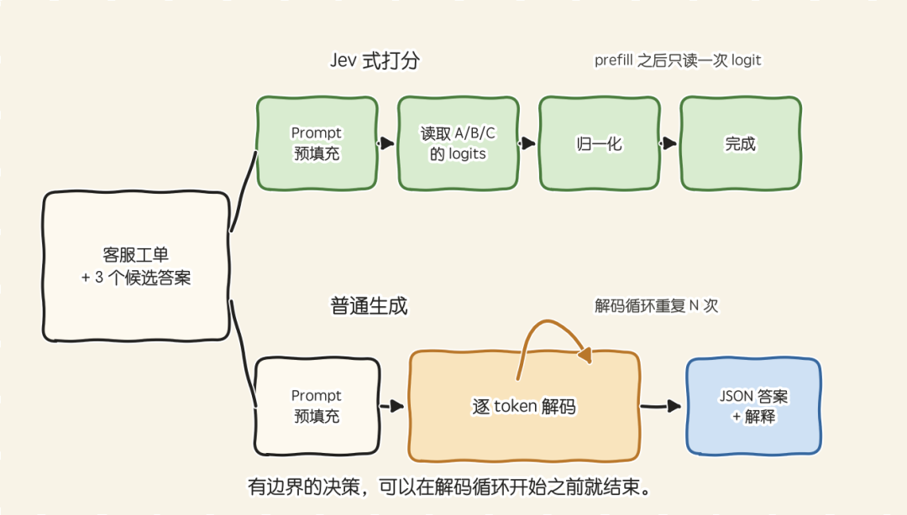
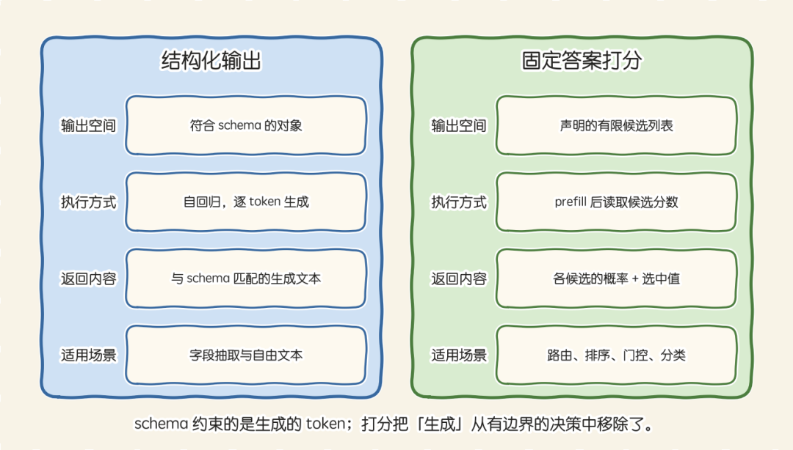
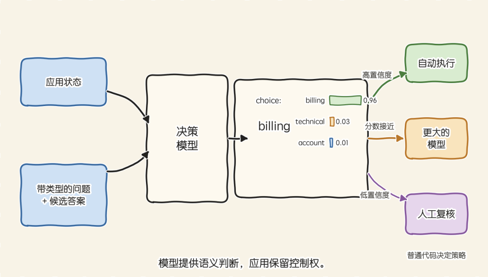
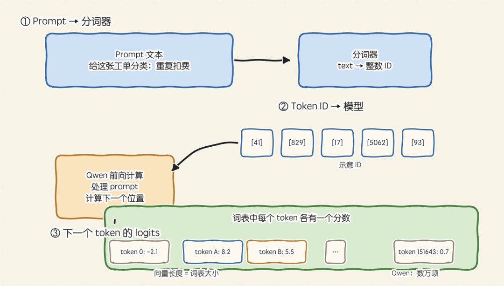
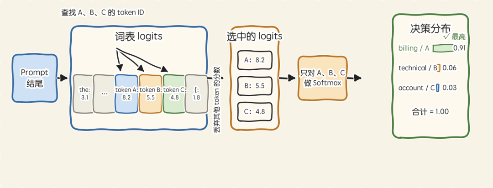
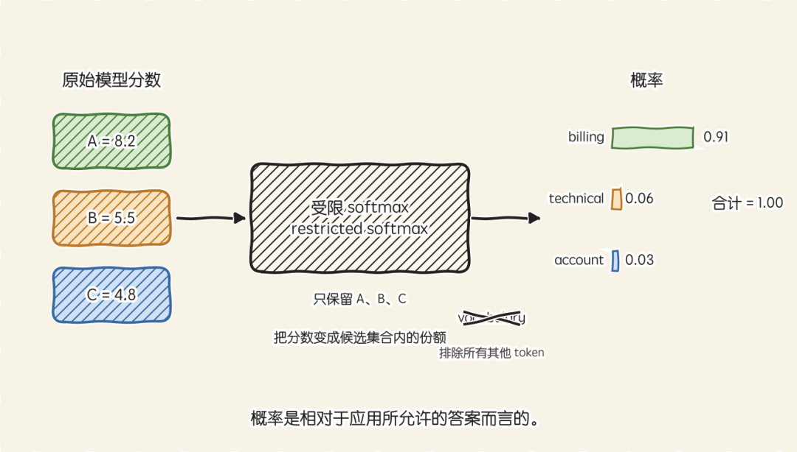
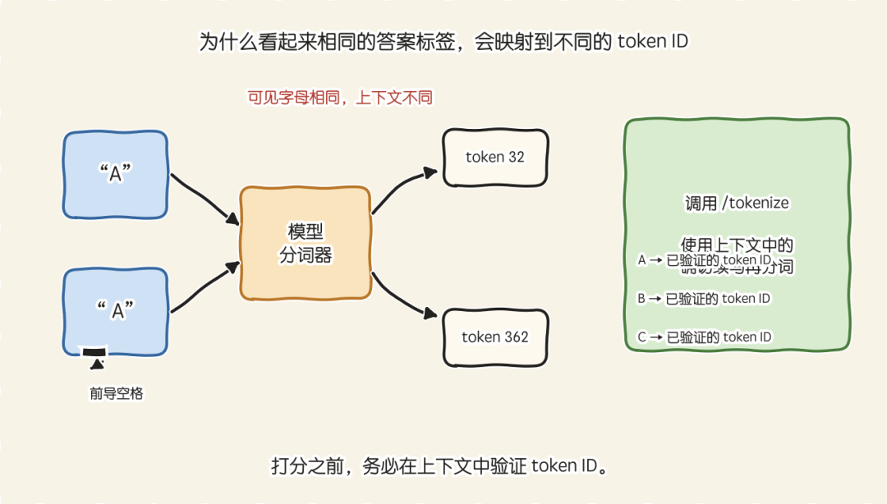
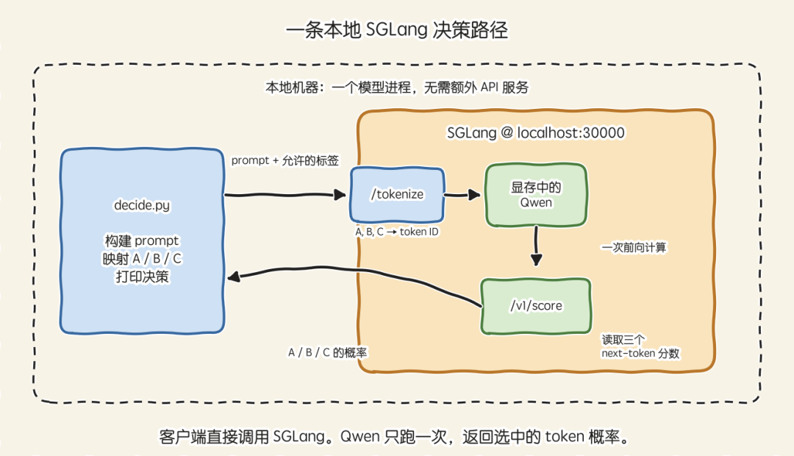
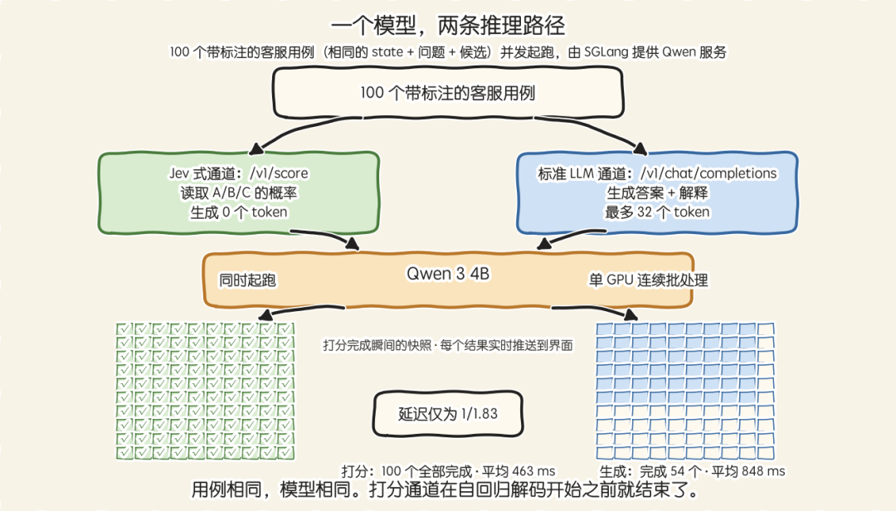

# 本地复刻一个 Jev：把开源大模型变成极速决策引擎（无需重新训练）

> 原文首发于微信公众号「Wenyan的呜哇」，2026-10-11。[阅读原文](https://mp.weixin.qq.com/s/8MGC8jVUUekn8SPXSosfqA)

> 原文：Build your own Jev (100% local) — Avi Chawla (@_avichawla)  
> 翻译整理自 X 长文  
> 原文链接：

## 引言

很多 LLM 调用根本不需要模型"写"出新文本。应用早就知道可能的答案有哪些，只需要模型从中选一个。

假设一张客服工单写着："同一笔订阅我被扣了两次费。"

应用需要把它分派给三个团队之一：账单（billing）、技术支持（technical support）或账户权限（account access）。

普通的 LLM 调用是让模型生成一段回答——可能是一句话、一个标签或一个 JSON 对象。应用要等这段文本生成完，再做解析，最后从中提取出选中的团队。



但如果所有合法答案都是已知的，这一步就完全没必要。

事实上，更优、更高效的做法是把同一个请求当作一次决策（这正是 Jev 做的事）：应用把工单和三个候选答案一起交给 Jev，模型一次性返回每个答案的得分：

```
billing            0.91technical support  0.06    account access     0.03
```

这里账单团队以最高概率胜出，而且应用代码能直接看到它赢得到底有多"稳"。

本文要在本地复刻的，就是 Jev 的这个行为：给定输入查询和候选答案列表，模型在一次打分请求中返回决策结果和概率分布，而不需要生成任何句子或 JSON 对象。

虽然 Jev 本身是闭源的，但这种推理模式在好几个开源模型上已经可以实现。具体来说，我们会用SGLang（通过 /v1/score 接口）来实现它，用Qwen 和 DeepSeek系列模型做测试，并把它与结构化输出、普通文本生成做对比。

先打好预防针：本文复刻的是推理路径，不是完整的 Jev 系统。Jev 还包含训练和校准（calibration）工作，这是打分接口无法提供的。

## 固定答案打分 ≠ 结构化输出

Jev 的机制很容易和结构化输出（structured output）混淆——两者都限制了应用能收到的结果，但它们在推理服务内部做的事完全不同。

还是上面那张工单，结构化输出可能让模型返回：

```
{ ”team”: ”billing” }
```

指定的 schema 保证了对象格式合法，但它本身并不会替你"选"出团队。

而且，在底层模型仍然是逐个 token 生成开头的花括号、字段名、字段值、结尾花括号。生成结束后，应用再去读 team 字段。

而打分（Jev 的做法）允许应用把三个团队作为完整候选列表直接提供给服务端。服务端只需读取每个候选的一个模型分数，返回上文展示的概率分布，完全不用生成 JSON 对象。



进一步，我们可以返回全部三个值（而不仅是最高分那个），让应用代码区别对待两种情况：

```
结果 1            结果 2     billing 0.91      billing   0.46     technical 0.06    technical 0.44     account 0.03      account   0.10
```

两个结果都会选出 billing。但第一个有明确偏好，第二个几乎平局。应用可以自动路由第一张工单，而把第二张送去人工复核。

另外，模型只负责给出分数，如何使用分数的规则由应用代码决定。比如可以规定：最高分必须超过 0.80，且领先第二名至少 0.20。这些阈值放在代码里，方便测试和调整。



需要注意：0.91 的意思是"在这三个候选中，billing 拿到了 91% 的概率质量"，而不是"模型有 91% 的概率是对的"。后者需要带标注的样本来度量——这就是后文会讨论的校准问题。

一句话总结：结构化输出生成的是一个格式合法的对象；固定答案打分返回的是应用已知答案上的分布。

## LLM 如何生成第一个输出 token

在讨论如何把因果语言模型变成 Jev 式模型之前，先理解常规生成过程：

1. **分词器（tokenizer）**先把 prompt 转成 token ID；
2. 模型处理这个序列，为下一个位置产出一个向量；
3. 这个向量的长度等于模型词表大小——每个词表 token 对应一个数字。比如 Qwen 的词表有几万个 token，向量就有几万个数字；
4. 这些原始数字叫 logits。logit 越大，模型越倾向于把对应 token 作为下一个续写。此时它们还不是概率；
5. 正常生成时，服务端对这个向量应用解码规则（温度等），选出一个 token，追加到 prompt 后面；
6. 模型再为下一个位置产出新的词表大小向量。生成/解码如此循环，直到遇到停止符或达到输出上限。



但当我们只想做一个有边界的决策时，我们关心的只有第一个向量。

回到客服路由的例子。应用接受三个答案：

```
billingtechnical supportaccount access 
```

在 prompt 里，可以给每个答案分配一个短标签：

```
A = billing  B = technical supportC = account access
```

prompt 最后要求模型只返回一个标签：

```
Route the support ticket into exactly one category.Ticket:I was charged twice for the same subscription.      Allowed labels:A = billingB = technical supportC = account accessReturn only the label.Label:
```

"Label:" 是 prompt 的最后一段文字，所以下一个位置就是模型正常会生成 A、B 或 C 的地方。

处理完这个 prompt 后，模型会为该位置产出常规词表大小的向量，其中包含 A 的 logit、B 和 C 的 logit，以及词表中所有其他 token 的 logit。

打分路径随后执行四步操作：

1. 找到 A、B、C 的 token ID；
2. 在词表向量的对应位置读出三个 logit；
3. 忽略其余所有 logit；
4. 对这三个值做 softmax。



如果三个 logit 分别是 8.2、5.5、4.8，受限 softmax 的结果约为 0.91、0.06、0.03。再把这些位置映射回 billing、technical support、account access 即可。

这个归一化是限定在声明的候选集合内的。我们不是在问"A 在整个词表上是否有 91% 的概率"，而是在问：在应用已排除其他所有回答之后，模型如何在 A、B、C 之间分配偏好。



这个操作SGLang 已经在/v1/score接口里实现好了：它把 prompt 跑一遍模型，读取指定 token 位置的分数并返回。我们无需修改 Qwen 实现、自己去提取最后的张量。

### 为什么用 A、B、C 而不是直接给单词打分？

为什么不直接对 "billing"、"technical support"、"account access" 这些词打分？因为一个可见的词不一定是单个 token：

- "billing" 对某个分词器可能是一个 token，对另一个可能拆成好几个；
- "technical support" 更是必然横跨多个位置。

对短语打分需要序列打分：给第一个 token 打分、追加它、再给下一个打分，最后合并整串的值。这样长度也会变成比较的一部分。

而单 token 标签避免了这个问题：每个选项都是同一输出位置上的一个词表条目，语义含义则放在 prompt 里：

```
A = billing questions and payment problemsB = product errors and technical failuresC = login, password, and account access problems
```

模型处理 prompt 时会读到这些描述，标签只是我们事后查看 logit 的那个 token。

### 必须验证每个标签是单 token

分词器常把前导空格编码进 token 里，所以 "A" 和 " A" 的 token ID 可能不同。聊天模板还可能在答案位置之前插入空白或控制 token。

稳妥做法是：用模型的聊天模板渲染完整 prompt，确认答案位置的确切续写内容，把它发给/tokenize，如果产出的不是恰好一个 token 就拒绝该标签。

这个标签映射完全留在打分客户端内部：应用发送的是语义化的选项（如 billing、technical_support），从不发送 token ID，也从不收到 A、B、C。这就是"公开 API 与模型标签解耦"的含义。

最后，答案列表还需要一条逃生通道：当候选集合覆盖不全时，受限 softmax 会把全部概率质量分给那几个错误选项。例如安全事件被路由到只含三个客服选项的路由器，就麻烦了。所以应该加上OTHER或ESCALATE选项，表示"以上都不对"。



## 用 SGLang 实现本地打分接口

本地示例只需要一个推理服务器：SGLang 把 Qwen 加载进 GPU 显存，暴露原生 HTTP 接口，Python 脚本直接向它发请求。完整流程：

1. 用 SGLang 启动一个 Qwen 模型；
2. 把决策写成带字母标签的 prompt；
3. 让 SGLang 对标签做分词；
4. 向 /v1/score 发一次请求；
5. 把返回的概率映射回候选答案。



### 第 1 步：用 SGLang 启动 Qwen

创建 Python 环境并安装两个依赖包：

```
python3 -m venv .venv source .venv/bin/activatepip install ”sglang[all]==0.5.10.post1” ”requests==2.34.2”
```

然后启动模型服务器：

```
python -m sglang.launch_server \   --model-path Qwen/Qwen2.5-0.5B-Instruct \  --host 127.0.0.1 \  --port 30000
```

首次启动会从 Hugging Face 下载模型，之后复用本地缓存。加载完成后 Qwen 常驻内存，SGLang 监听 30000 端口。这个 SGLang 进程就是推理服务，运行下面的客户端时保持它运行。

### 第 2 步：定义候选并构建 prompt

创建 decide.py：

```
import jsonimport requestsBASE_URL = ”http://127.0.0.1:30000”   MODEL = ”Qwen/Qwen2.5-0.5B-Instruct” choices = {    ”A”: ”billing and payments”,    ”B”: ”technical support”,    ”C”: ”account access”,}        ticket = ”I was charged twice for the same subscription.”choice_lines = ”\n”.join(     f”{label} = {meaning}” for label, meaning in choices.items()   )prompt = f”””Ticket:  {ticket} Question:Which category matches the ticket?Allowed labels:   {choice_lines}    Return only the label.   Label:      ”””     print(prompt)
```

字典同时记录答案的两种表示："A" 是我们要打分的 token，"billing" 是返回给应用的语义。从分词、打分到结果映射，顺序必须保持一致。

生成的 prompt 如下（注意结尾停在 "Label:"，我们要的是模型对下一个 token的打分，而不是让 SGLang 生成它）：

```
Ticket:I was charged twice for the same subscription.      Question: Which category matches the ticket? Allowed labels:A = billing and payments   B = technical support  C = account access      Return only the label.  Label:
```

### 第 3 步：解析标签的 token ID

在 prompt 代码下面追加：

```
label_token_ids = []      for label in choices:    response = requests.post(        f”{BASE_URL}/tokenize”,        json={            ”model”: MODEL,            ”prompt”: label,            ”add_special_tokens”: False,        },        timeout=30,    )          response.raise_for_status()    token_ids = response.json()[”tokens”]          if len(token_ids) != 1:        raise ValueError(            f”{label!r} is not a single token: {token_ids}”        )    print(f”{label!r} -> {token_ids}”)    label_token_ids.append(token_ids[0])
```

SGLang 的 /tokenize 接口返回 Qwen 分词器产生的整数 ID。任何变成多个 token 的标签都会被拒绝——打分请求需要每个答案对应词表上的一个位置。

对 Qwen/Qwen2.5-0.5B-Instruct，输出为：

```
'A' -> [32]'B' -> [33]'C' -> [34]
```

每个列表恰好一个整数，说明每个标签占一个 token。后面的打分请求将读取词表位置 32、33、34。这个检查还防止我们误以为不同模型的分词行为一致——对 Qwen 好用的标签，换个分词器可能就拆了。

### 第 4 步：向 SGLang 请求三个概率

继续追加打分请求：

```
response = requests.post(    f”{BASE_URL}/v1/score”,    json={        ”model”: MODEL,        ”query”: prompt,        ”items”: [””],        ”label_token_ids”: label_token_ids,        ”apply_softmax”: True,    },     timeout=120,)      response.raise_for_status() score_response = response.json()  print(json.dumps(score_response, indent=2))scores = score_response[”scores”][0]
```

参数含义：

- query：完整 prompt；
- items里的空字符串：表示给紧跟其后的位置打分；
- label_token_ids：告诉 SGLang 从 Qwen 的词表大小输出里读哪三个条目；
- apply_softmax：把这三个条目归一化成概率。

用同一个 Qwen checkpoint 实际运行得到：

```
{  ”scores”: [    [      0.67776233,      0.310878605,      0.011359035    ]  ]}
```

三个位置分别对应 A、B、C；softmax 之前的 logit 分别是 25.277620、24.498226、21.188837。不同硬件和精度设置下可能出现细微数值差异。

官方接口文档说明每个返回列表的顺序与 label_token_ids 一致：第一个分数属于 A，第二个属于 B，第三个属于 C。

### 第 5 步：把模型标签映射回决策

脚本最后加上映射代码：

```
probabilities = {    choices[label]: float(score)    for label, score in zip(choices, scores, strict=True)}decision = max(probabilities, key=probabilities.get)print(    json.dumps(        {            ”decision”: decision,            ”probabilities”: probabilities,        },        indent=2,    ))
```

在第二个终端运行 python decide.py：

```
{    ”decision”: ”billing and payments”,    ”probabilities”: {    ”billing and payments”: 0.6777623295783997,    ”technical support”: 0.31087860465049744,    ”account access”: 0.011359035037457943  } }
```

SGLang 在 /v1/score 背后完成了全部计算：一个 SGLang 进程分词标签、跑一次 Qwen、返回选中的概率。

这个例子里 billing 胜出，但概率只有 0.678。如果策略要求 0.70，这张工单就会被送去人工复核而不是自动路由。这个阈值应该来自带标注样本的评估。

## 打分延迟 vs 自回归生成的实测

上面的单请求示例展示了机制。作者还搭了一个小应用，在多个决策上测试该机制的表现。部署的 demo 支持多个开源模型：Qwen 3 4B、Qwen 2.5 0.5B 和 1.5B、SmolLM2 1.7B、TinyLlama 1.1B、DeepSeek-R1-Distill-Qwen 1.5B 等。

Jev 式通道调用决策方法：

```
result = engine.decide(request)   answer = result[”answers”][”decision”]  choice = answer[”choice”]probabilities = answer[”probabilities”]
```

decide() 内部，SGLang 通过 /v1/score 接收 prompt，请求中包含 A、B、C 的 token ID。SGLang 跑一遍 prompt，读出那三个 next-token 分数，归一化，然后停止——响应里没有生成的 token。

标准通道则在同一个引擎上调用生成方法：

```
result = engine.generate_response(    case[”state”],    case[”question”],    list(case[”criteria”].items()),    max_tokens=32,)
```

这个方法把同样的状态、问题和选项发给 /v1/chat/completions，Qwen 生成一个答案和简短解释（最多 32 个 token），应用在前 100 个字符里搜索允许的选择名，解析出的选择与存储标签一致就判对。

实测里速度差异立竿见影，原因前面已经讲过。

作者还基于固定本地数据集模拟了 100 个用例，当前数据集覆盖客服路由、候选人筛选和报销审核，期望标签让界面能同时展示速度和正确率。

远程 SGLang 路径用同一个屏障（barrier）启动两个 worker：

```
starting_line = threading.Barrier(2)def worker(lane, runner):    starting_line.wait()    for case in cases:        updates.put(runner(case))    workers = [        threading.Thread(target=worker, args=(”jev”, run_jev)),      threading.Thread(target=worker, args=(”llm”, run_llm)),      ]for worker_thread in workers:    worker_thread.start()
```

屏障同时释放两个 worker，每条通道按顺序处理自己的用例：Jev 式 worker 上一个请求一完成就发下一个打分请求，标准 worker 对生成请求做同样的事。两条通道同时活跃，但不是一次性把 200 个请求全发出去——SGLang 接收两条通道的并发工作，通过continuous batching调度，两类请求共享同一块 GPU、内存带宽和调度器。

两个车道同时起跑，用的是同一个 SGLang 服务器上的 Qwen/Qwen3-4B-Instruct-2507。



## 如何选择正确的方法

打分不能替代生成。Jev 的做法只适用于：应用在推理之前就已经定义好了输出空间。

一个合适的 workload 应当具备：

- 一组有限的、有意义的标签；
- 每个标签能映射到一个不同的下游动作；
- 调用方只需要标签及其概率分布，不需要新文本。

结构化输出则是另一回事：它定义的是响应的语法，解码器仍要逐 token 生成字段名和值。当那些值事先无法枚举时，就该用结构化生成——只有当候选值已知时，打分才能省掉解码过程。

三种方式的对比：

|  | 常规 LLM 解码 | 结构化输出 | Jev 式打分 |
| --- | --- | --- | --- |
| 输出内容 | 自由文本 | 语法合法的 JSON 等对象 | 已知候选上的概率分布 |
| 解码方式 | 逐 token 自回归生成 | 仍逐 token 生成字段名和值 | 只读第一个 next-token 向量，无需自回归循环 |
| 适用场景 | 推理前不知道输出内容 | 值的集合事先无法枚举 | 输出集合已知，且"选择"就够了 |

根据所需输出来选推理路径：

- 输出内容未知 → 生成；
- 输出集合已知，且只要做出选择就够 → 打分。此时第一个 next-token 向量里已经包含排序，直接返回这个排序，就跳过了调用方并不需要的自回归循环。

再强调一次：本文项目复刻的是Jev 式的推理机制，并不包括 Jev 的权重、RLCD（Reinforcement Learning from Contrastive Distillation）训练流程和评估体系。这些作者打算后续再写，敬请期待。

## 总结

- 很多 LLM 调用的本质是"决策"而非"生成"：候选答案已知时，直接对第一个 next-token 的 logits 做受限 softmax，一次前向计算就能拿到完整概率分布；
- 单 token 标签（A/B/C）绕开了短语序列打分的麻烦，标签与 token ID 的映射封装在客户端内部，公开 API 保持语义化；
- 别忘了给候选集加 OTHER / ESCALATE 逃生通道，并记住"概率"≠"正确率"，阈值要靠带标注数据校准；
- SGLang 的 /v1/score 开箱即用，用 Qwen、DeepSeek 等开源模型就能 100% 本地跑通；
- 打分适用于输出集合已知的场景；输出内容未知或值无法枚举时，仍然要用生成或结构化输出。

That's a wrap!

如果你喜欢这个教程：

- 找到作者 → X 账号 @_avichawla
- 他每天都在分享 DS、ML、LLM 和 RAG 相关的教程与洞见
