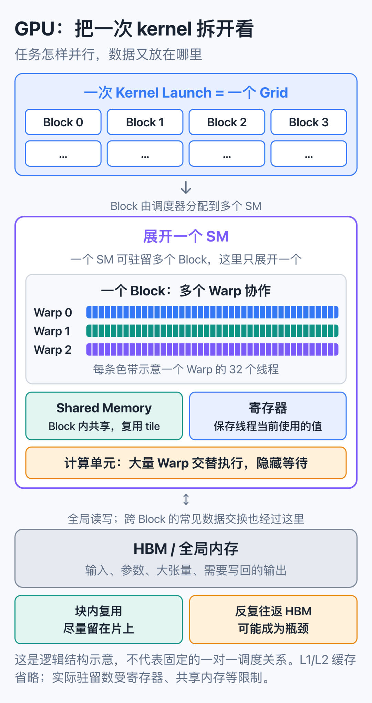
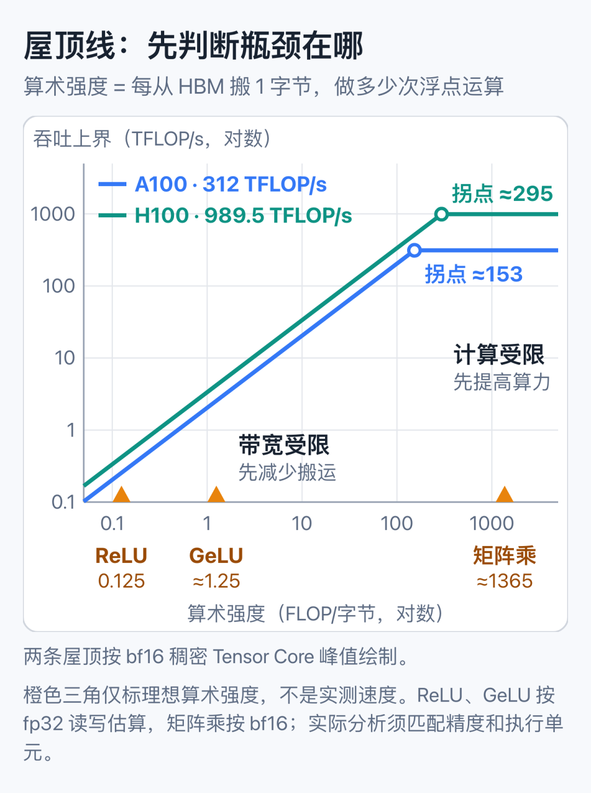
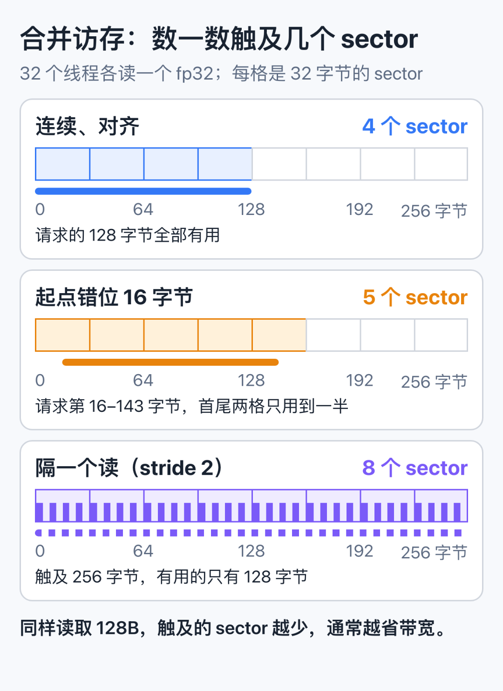
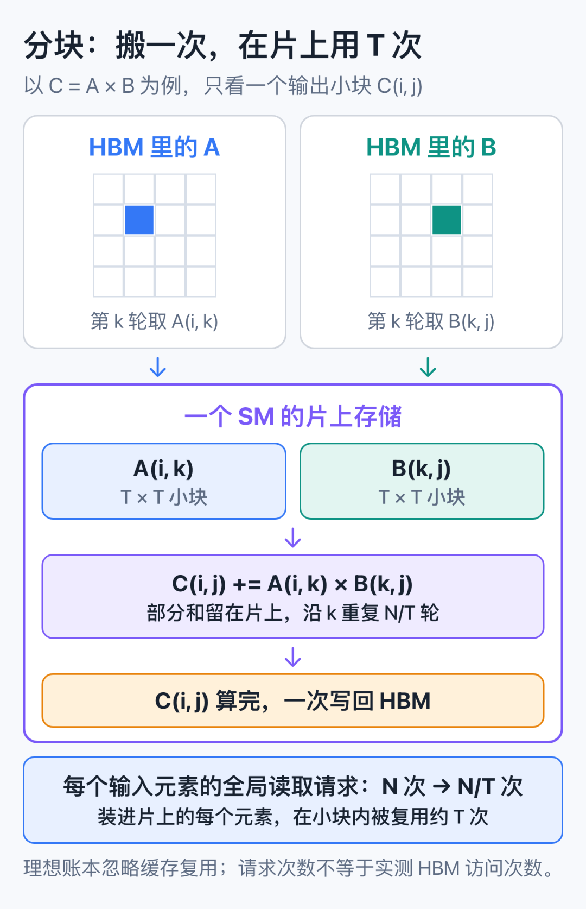
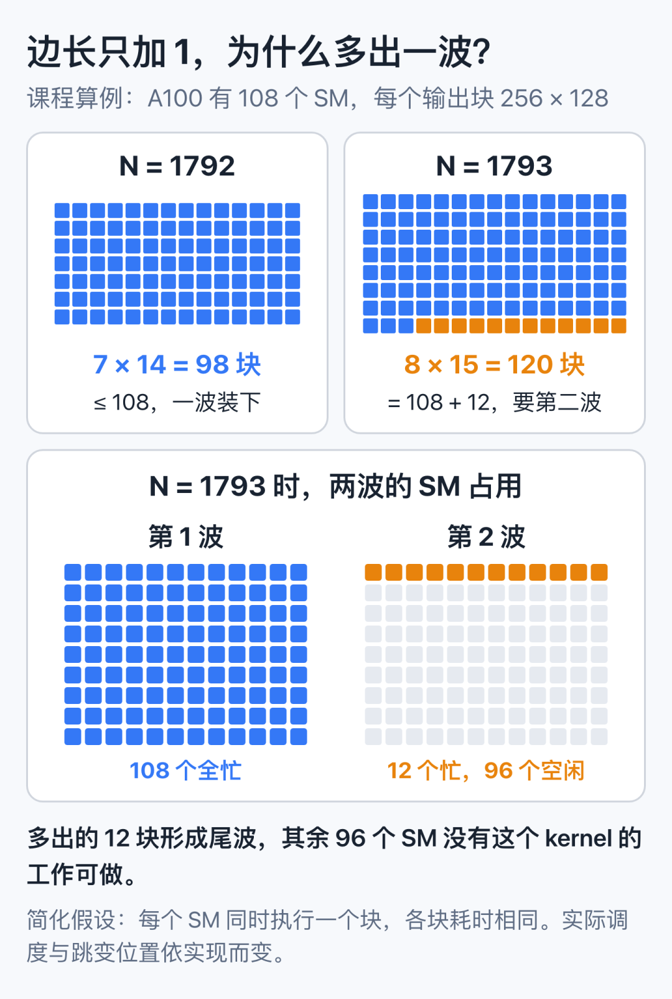
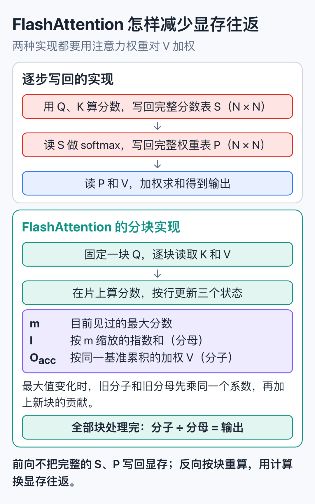

# 从算力到带宽：斯坦福 CS336 第 5–6 讲精读

> 原文首发于微信公众号「Wenyan的呜哇」，2026-11-08。[阅读原文](https://mp.weixin.qq.com/s/DOsRQEMilEPqQWdViGbHtg)

> 从 8.15 ms 到 1.13 ms：CS336 第 5–6 讲，带你看懂 GPU 优化里的数据搬运、Triton 与 FlashAttention。

同样一块 H100，同样一个 16384×16384 的 fp32 矩阵，同样在计算 tanh 近似 GeLU。

五种实现的课程记录耗时如下：

| 实现方式 | 耗时 | 核心差别 |
| --- | --- | --- |
| 用PyTorch 手写公式 | 8.15 ms | 多 kernel，产生中间张量 |
| 内置 GeLU | 1.13 ms | 库提供的融合实现 |
| 手写 CUDA | 1.845 ms | 单 kernel，逐线程计算 |
| Triton | 1.848 ms | 按数据块表达计算 |
| torch.compile | 1.470 ms | 自动融合手写公式 |

它们算的是同一个 GeLU，只是实现路径不同：用PyTorch 手写公式是把公式拆成张量运算；内置 GeLU是调用库里优化好的现成算子；手写 CUDA是用 C++ 自己编写较底层的 GPU kernel；Triton是用 Python 语法描述块级 GPU kernel；torch.compile是保留原公式，让编译器自动完成融合等优化。

先说明口径：这些耗时来自课程公开执行记录，并非本文重新跑出的基准；后文代码取自课程官方讲义与作业。

数学目标没有变，为什么最慢和最快能差七倍多？

答案不在 Python 语法里，也不只在 FLOPs 里。一个关键区别是：中间结果要不要反复写回显存，再被下一步读出来。

手写公式会拆成多个 GPU 计算步骤，产生一串中间张量；内置实现则把许多步骤合在一个 kernel 里。所谓kernel，就是一次提交给 GPU 执行的计算程序。一行 PyTorch 表达式，可能对应一个，也可能对应多个 kernel。

这也是 CS336 第 5–6 讲的核心视角：

> 判断一段 GPU 程序快不快，至少要算三本账：做了多少运算，搬了多少数据，硬件有多少时间在空等。

本文就从这七倍差距出发，最后一路讲到 FlashAttention：它为什么没有减少注意力的渐近计算量，却能更快、更省显存。

## 一、同一个 GeLU，五种写法差在哪里

这里的“手写 PyTorch 公式”并不是用 Python 循环逐个元素计算。底层同样在 GPU 上执行，区别在于：表达式被拆成了多少步，每一步是否都要读写整块数据。

### 先算一笔最低搬运账

输入矩阵约有 2.68 亿个元素。即使所有中间运算都留在片上，至少也要读一次输入、写一次输出：

```
最低读写量 = 2.68 亿 ×（读 4 B + 写 4 B）≈ 2.15 GBH100 理想搬运时间 = 2.15 GB ÷ 3.35 TB/s ≈ 0.64 ms
```

内置版用 1.13 ms，按必要数据量折算，有效带宽约为1.90 TB/s；手写 CUDA 用 1.845 ms，折算约为1.16 TB/s。

这里的“有效带宽”只是用必要数据量除以耗时，不是硬件计数器测到的真实 HBM 带宽。它能帮助我们检查量级，却不能单独解释差距究竟来自缓存、指令效率还是访存方式。

对这类大张量，未融合公式的多次中间读写是首要怀疑对象；对小算子，微秒级的 kernel 启动成本反而可能更加突出。同一种优化，在不同规模下可以通过不同机制获益。

### 不是最快，为什么还要关注 Triton？

因为它在这里的价值不是夺冠，而是把融合 kernel 的数据流展示清楚：数据块怎么划分、越界怎么处理、什么时候读写，都直接写在代码里。内置 GeLU 和 torch.compile 则把这些细节更多交给库或编译器。

本例中，Triton 的 1.848 ms 几乎追平手写 CUDA 的 1.845 ms，说明较高层的表达也能得到高效实现；但这不代表它通常都能追平 CUDA。

课程的包装函数负责分配输出并启动 grid，这里省略这部分准备工作。每个 program 覆盖 1024 个元素，真正值得看的是下面的 kernel。如果不想读代码，也可以直接跳到后面的四个要点。

```
@triton.jitdef triton_gelu_kernel(    x_ptr, y_ptr, num_elements, BLOCK_SIZE: tl.constexpr): # 1. 确定当前 program 负责的数据块    pid = tl.program_id(axis=0)    block_start = pid * BLOCK_SIZE# 2. 生成块内索引，并排除越界元素    offsets = block_start + tl.arange(0, BLOCK_SIZE)    mask = offsets < num_elements # 3. 读取输入，中间计算留在片上    x = tl.load(x_ptr + offsets, mask=mask)     a = 0.79788456 * (x + 0.044715 * x * x * x)    exp = tl.exp(2 * a)    tanh = (exp - 1) / (exp + 1)    y = 0.5 * x * (1 + tanh) # 4. 只写回最终输出    tl.store(y_ptr + offsets, y, mask=mask)
```

只需抓住四件事：

1. program_id 告诉当前 program：“你负责哪一块”；
2. arange 生成块内索引，mask排除越界元素；
3. a、exp、tanh 等临时值由编译器管理，不必逐项写回 HBM；
4. 必要的数据流只有最后看得到的两次：读输入、写输出。

因此，Triton 提供的是较高层、可控的 kernel 表达方式，不是自动加速保证。日常使用优先选择内置算子和 torch.compile；需要自定义融合逻辑、新算子或特殊数据流时，再考虑 Triton，最终仍要靠测量说话。

## 二、为什么会这样：GPU 的算力与搬运是两种资源

要理解上面的差距，只需要先建立一个简化机器模型。

GPU 有许多SM（Streaming Multiprocessor）。一次 kernel 启动会发出大量 thread block，每个 block 被安排到一个 SM 上。块内线程可以利用共享内存协作；常见模型下，跨块交换数据则通常需要经过全局内存或额外同步机制。

线程还有一个更底层的分组：warp，通常包含 32 个线程。warp 内如果走向不同分支，会产生分支发散；当一个 warp 等待内存时，SM 又能切换到其他就绪 warp，隐藏一部分等待。

数据则分布在不同层级：

- 寄存器：保存正在使用的值。快，但容量小，占用过高会降低并发。
- L1 与共享内存：前者用于缓存，后者支持块内协作；共享内存适合显式复用 tile。
- L2：整卡共享缓存；block 遍历顺序会影响命中率。
- HBM / 全局内存：保存参数和大张量；容量大，但反复往返代价高。

把任务划分和数据位置放进同一张图，就能更直观地看到这些概念的关系：



【插图 1｜GPU 的执行与存储层级】

高性能 kernel 的常见形态因此是：

> 把一小块数据搬到片上，尽量复用，再写出必要结果。

### 屋顶线：先判断瓶颈在哪本账

把一段工作的浮点运算量记为 F，从 HBM 读写的数据量记为 B，则：

```
算术强度 I = F / B吞吐上限 ≈ min（对应路径的峰值算力，HBM 带宽 × I）
```

算术强度低时，带宽先成为上限；强度高过拐点后，峰值算力先成为上限。



【插图 2｜A100 与 H100 的屋顶线】

逐元素 ReLU 的每个 fp32 元素至少读 4B、写 4B，若粗略按一次操作估算，强度只有1/8。GeLU 即使用约 10 次操作估算，强度也只有约1.25。它们通常更容易受存储系统限制。

矩阵乘则拥有更多复用机会。对 N×N 方阵乘，运算量约为 2N³。如果每个元素占 b 字节，A、B、C 的最低流量为 3bN²：

```
I = 2N³ / 3bN² = 2N / 3b
```

因此 bf16/fp16 的理想强度为N/3，fp32 为N/6。大矩阵乘更容易越过拐点，但小矩阵仍可能受并行度、启动和调度限制。

图中有两个细节值得注意：

- 两条屋顶线按 bf16 稠密 Tensor Core 峰值绘制；
- ReLU、GeLU 的橙色三角只标出理想算术强度，不代表实测速度。

分析真实程序时，必须让峰值算力与精度、执行单元匹配。A100 普通 FP32 峰值约 19.5 TFLOPS，bf16/fp16 稠密 Tensor Core 峰值则是 312 TFLOPS。这个 16 倍差距同时改变了精度和计算路径，不能理解成“任意代码换 fp16 都快 16 倍”。

屋顶线给出的也只是上限，不是性能保证。额外做无用计算同样能让算术强度变大，却不会让程序更快。

## 三、六种优化技巧，分别在改哪本账

有了这三本账，课程中的六种技巧就不再是零散名词。

### 1. 低精度：减少每个数的字节数

fp32 占 4B，fp16/bf16 占 2B。读写都改为 16 位时，搬运量可以减半，算术强度相应翻倍，还可能使用吞吐更高的 Tensor Core 路径。

代价是数值范围和舍入误差。fp16 常配合损失缩放；bf16 的指数范围与 fp32 接近，但有效数字更少。低精度不是无损开关，要同时检查质量、稳定性和实际 kernel 路径。

### 2. 算子融合：让中间结果留在片上

融合减少的是中间张量读写和 kernel 启动次数。它还常能减少反向传播需要保存的信息，但具体收益取决于计算图、编译器和资源占用。

softmax 能把这笔账算得很具体。设输入有 M 行、每行 N 个元素，朴素拆分执行的逻辑读写为：

- 求每行最大值：读 MN，写 M；
- 减去行最大值：读 MN + M，写 MN；
- 取指数：读 MN，写 MN；
- 求每行指数和：读 MN，写 M；
- 除以指数和：读 MN + M，写 MN；
- 合计：读 5MN + 2M，写 3MN + 2M。

如果整行及必要状态能放在片上，理想情况下只需读 MN、写 MN。N 较大时，逻辑读写总量约缩小到原来的四分之一。

这不是保证四倍加速：指数、归约和同步仍要花时间，缓存也会改变真实 HBM 流量。但它清楚说明了融合为什么有效。

### 3. 重计算：少保存一些，反向时再算

反向传播需要前向信息。激活检查点只保存部分边界输入，等反向需要中间结果时重新计算，用额外 FLOPs 换显存和读写。

重算不是免费。它通常首先解决“模型能否装得下”，是否更快需要另测。FlashAttention 的反向传播也采用了这一思路。

### 4. 合并访存：相邻线程尽量读相邻地址

一个 warp 的 32 个线程各读一个 fp32，共需 128B。按典型 NVIDIA 全局访问的 32B sector 口径，连续且对齐时覆盖 4 个 sector；错位 16B 覆盖 5 个；隔一个元素读取则覆盖 8 个。



【插图 3｜三种地址模式触及的 sector 数量】

有效数据没有变，存储系统需要处理的范围却变大了。要注意的是，这张图比较的是请求覆盖的 sector，不等于直接测出了 HBM 流量；缓存和相邻 warp 的复用还会改变最终成本。

### 5. 分块：搬进来的数据，在片上多用几次

矩阵乘会反复使用同一个输入元素。分块让一组线程共同计算一个 T×T 输出块，每轮把一对 A、B 小块搬到片上，完成部分累加后再处理下一对。



【插图 4｜矩阵乘分块与片上复用】

在课程的理想账本里，每个输入元素的全局读取请求由 N 次降为 N/T 次；输出部分和始终留在片上，最后才写回。

但块不是越大越好。大块会占用更多寄存器和共享内存，可能降低 SM 同时保留的 block 数，还会影响边界效率与并行度。

### 6. 减少分支发散：让 warp 尽量一起推进

同一 warp 中如果一部分线程走 A 分支，另一部分走 B 分支，硬件需要分别处理不同路径。优化重点是让相似工作尽量一起执行，而不是机械删除所有 if。边界掩码很常见，也不意味着一定要消除。

> 一句话总结：低精度减少字节，融合减少往返，重计算减少保存，合并访存减少无效区域，分块增加复用，控制分支发散提高执行效率。

## 四、矩阵边长只加 1，为什么可能多等一波

还有一类“性能玄学”，与数据块数量有关。

课程举了一个简化例子：A100 有 108 个 SM，假设每个 SM 同时执行一个输出块，各块耗时相近，输出块形状为 256×128。

```
N = 1792：7 × 14 = 98 个块，一波装得下N = 1793：8 × 15 = 120 个块，变成 108 + 12
```

边长只增加 1，却同时跨过了两个方向的块边界。前 108 个块完成后，还剩 12 个块形成尾波，其余 96 个 SM 没有这个 kernel 的工作可做。



【插图 5｜1792 与 1793 的输出块数量及尾波】

这就是波量化。它解释了为什么矩阵乘耗时曲线不一定平滑。

但这只是机制示意，不是通用耗时公式。真实实现可能让一个 SM 同时驻留多个 block，也可能因尺寸变化改选另一套 kernel。比较性能时，还要看纵轴究竟是毫秒还是 TFLOPS：大矩阵吞吐更高，不代表完成时间更短。

## 五、FlashAttention：把前面的技巧组合起来

现在来到两讲最有代表性的综合应用。

### 注意力真正贵在哪里

忽略 batch、head 和 mask 等实现细节，单头注意力的核心是：

```
S = QKᵀ / √dP = softmax(S)O = PV
```

这里有QKᵀ 和 PV 两次矩阵乘，中间夹一个 softmax。

逐步执行的朴素实现会把完整的 N×N 分数矩阵 S、权重矩阵 P 写入显存，再读回来。这叫物化中间矩阵。序列变长时，二次规模的存储和读写都非常昂贵。

FlashAttention 的目标不是改变注意力定义，而是：完整的 S、P 不写入 HBM，仍算出相同的注意力结果。



【插图 6｜朴素注意力与 FlashAttention 的数据流】

它以一块 Q 为单位，逐块读取 K、V。每次只在片上产生一个较小的分数块，然后立即更新归一化状态和输出累计值。

真正难的地方是：softmax 需要整行最大值和指数和，后面的分数还没看到，前面的权重就不能最终确定。

### 在线 softmax：必须同时维护三个状态

FlashAttention 为每一行维护：

- m：目前见过的最大分数；
- l：按当前 m 缩放的指数和，也就是分母；
- O_acc：按同一个 m 缩放的 V 加权和，也就是分子。

新块到来时，如果最大值由 m_old 变为 m_new，旧分子和旧分母必须一起乘：

```
α = exp(m_old - m_new)
```

然后才能加入新块贡献：

```
l_new = α × l_old + rowsum(P_tilde)O_new = α × O_old + P_tilde × V
```

只更新分母、忘记修正已经累计的分子，结果就会出错。

### 用三个数手算一遍

设某个查询对三个位置的分数为 [1,2,3]，对应的 V 简化成 [10,20,30]。

第一块包含 [1,2]，最大值为 2：

```
m = 2l = e^(1−2) + 1 ≈ 1.368O_acc = e^(1−2) × 10 + 1 × 20 ≈ 23.679
```

第二块只有分数 3，对应 V=30。新最大值变成 3，旧状态都要乘 e^(2−3)：

```
α = e^(2−3) ≈ 0.368 新分母 l = 1.367879 × α + 1         ≈ 1.503215 新分子 O_acc = 23.678794 × α + 30             ≈ 38.710942 最终输出 O = O_acc / l ≈ 25.752
```

直接把三个位置一起归一化，也会得到同一个结果：

```
O = (e⁻² × 10 + e⁻¹ × 20 + 30) / (e⁻² + e⁻¹ + 1)  ≈ 25.752
```

关键不是记住三个变量名，而是理解：分子和分母始终使用同一个指数缩放基准。

### FA2 前向：真正核心的状态更新

作业 2 的外层循环固定一块 Q，内层逐块读取 K、V。省略 mask 等边界细节，每一轮真正需要理解的更新只有这些：

```
S = Qi × Kjᵀ / √dm_new = max(m, rowmax(S))P_tilde = exp(S - m_new)α = exp(m - m_new) l = α × l + rowsum(P_tilde)O_acc = α × O_acc + P_tilde × Vjm = m_new
```

所有 K/V 块处理完后，再计算 O=O_acc/l 和 L=m+log(l)，写回 O 与 L。前者是真正归一化的输出，后者保存每行的 logsumexp，供反向传播使用。反向阶段不保存完整 S、P，而是利用 Q/K/V、O、L 按块重算，用额外计算换显存和读写。

### 三个最容易误解的地方

第一，FlashAttention 没有把稠密注意力变成线性计算。固定头维度时，计算量仍随 N² 增长；反向重算还会增加部分实际 FLOPs。

第二，存储近似线性，不等于总 HBM 读写也必然线性。不同 Q 块仍可能重复读取 K/V，实际流量取决于块大小和片上存储容量。

第三，“精确注意力”不等于逐 bit 相同。它指不使用稀疏、低秩等近似来改变注意力定义；分块改变浮点求值顺序，仍可能产生正常的舍入差异。

所以，FlashAttention 真正展示的是一种 IO-aware 的算法设计：不是只问数学上算什么，而是同时问每个中间值要活多久、放在哪里、需要搬几次。

## 六、把方法用回自己的模型：先测量，再优化

读完这些原理，最重要的不是立刻手写 kernel，而是建立一条可靠的优化流程。

### 第一步：把耗时测准

CUDA kernel 通常异步执行。CPU 提交后会继续推进，因此“提交完成”不等于“计算完成”。

课程官方 benchmark 做了三件事：

1. 先预热，把编译、初始化等一次性成本与稳态测量分开；
2. 在计时边界调用 torch.cuda.synchronize()，也可以使用 CUDA event；
3. 重复测量，而不是只报告一次结果。

还要先说清测量边界：只测前向，还是包含反向和优化器更新？不同边界不能混着比较。

### 第二步：找到真正的热点

PyTorch profiler 可以关联上层算子与底层 CUDA kernel；Nsight Systems 适合看 CPU、GPU、通信和 kernel 的时间关系；Nsight Compute 可以进一步分析单个 kernel 的带宽、指令和占用率。

如果瓶颈是显存，还可以记录 PyTorch 内存分配历史，用 memory_viz 查看峰值与张量来源。

### 第三步：按瓶颈选择工具

- 中间结果反复往返：优先检查融合和 torch.compile；
- 数值路径允许：评估低精度和混合精度；
- 激活占用过高：评估激活检查点；
- 地址访问分散：调整线程到数据的映射；
- 输入反复读取：检查 tile 与缓存复用；
- 尾部 SM 空转：检查 block 数量、尺寸和波量化；
- 某个 kernel 很快但整体没变：看它原本占总时间多少。

局部加速也不会自动等比例变成整体加速。一个只占训练时间 10% 的 kernel，即使耗时减半，整体也只从 100 降到 95。

## 写在最后

CS336 这两讲最有价值的，不是某个孤立的 Triton 写法，而是一套统一的分析方式。

面对一段 GPU 程序，分别问：

1. 运算账：真正需要多少 FLOPs，使用的是什么精度和执行单元？
2. 搬运账：中间结果写到了哪里，是否被反复读取，能否在片上复用？
3. 并行账：有多少 SM、warp 或 block 在等待，是否存在分支发散和尾波？

GeLU 展示了最小形态：一次读、一次写，中间值不落地。

FlashAttention 展示了更复杂的形态：分块、融合、在线状态和反向重算，共同消除二次规模的中间矩阵。

这也是“FLOPs 不等于运行时间”的具体含义。真正高性能的实现，往往在数学公式之外，重新设计了数据流。

## 追问

### 1. 算术强度越过拐点，程序就一定能跑满算力吗？

不一定。屋顶线给出的是资源约束下的上限。跨过拐点，只表示在这个模型里，峰值算力成为更低的那道上限。程序仍可能因为并行任务不足、指令依赖、同步或执行路径不匹配，远远达不到它。

还要检查你的强度是实测值，还是用“每个矩阵只搬一次”算出的理想值。假设中的复用没有实现，实际强度就会更低；拿 fp32 普通指令去对照 bf16 Tensor Core 峰值，也会选错屋顶。（对应正文：第二、四节）

### 2. 某个算子受带宽限制，换更快的 GPU 就没用了吗？

要看“更快”指什么。如果只提高算力、其他条件不变，纯带宽受限部分的收益可能有限；如果新卡同时提高带宽，仍然可能变快。

在理想带宽受限、流量相同的条件下，用本文的 A100 与 H100 带宽估算，H100 用时约为 A100 的 2.039/3.35≈61%。实际结果还会受到缓存、启动开销和实现差异影响。（对应正文：第二节）

### 3. 融合和激活检查点都能省显存，为什么不是同一种优化？

融合改变操作之间怎样传递中间结果，检查点改变哪些信息要一直保存到反向。连续几个逐元素操作融合后，中间量可以留在片上；检查点则允许这些操作在反向阶段重新执行。

两者可以组合。一个 TransformerBlock 即便已经编译融合，反向仍可能需要保存很多信息，此时检查点仍有价值。还要区分显存容量与读写流量：峰值占用降低，并不保证累计搬运量降低。（对应正文：第三节）

### 4. 分块能复用数据，为什么不把块开到最大？

块变大，每次加载的数据可能被更多计算复用，但寄存器和共享内存占用也会上升。如果一个 SM 原本能保留多个 block，现在只能保留一个，在某些 warp 等数据时，就可能缺少其他就绪工作来隐藏延迟。

大块还可能增加边界上的无效计算，并减少输出块总数，让并行度不足或尾波更明显。因此调参时要同时看耗时、资源占用和任务分布，不能只算复用次数。（对应正文：第三、四节）

### 5. 矩阵更大时 TFLOPS 更高，是不是代表它算得更快？

这里混淆了吞吐更高与完成时间更短。假设小矩阵执行 1 单位工作耗时 1 ms，大矩阵执行 4 单位工作耗时 2 ms，后者吞吐翻倍，却仍花了更长时间。

矩阵变大有时能让硬件利用得更充分，尺寸改变也可能触发新的 kernel 或额外尾波。比较曲线时，先看纵轴是毫秒还是 TFLOPS，再讨论“快”。（对应正文：第四节）

### 6. FlashAttention 为什么不能让每个块单独做 softmax？

因为 softmax 的分母属于整行。用正文的 [1,2] 和 [3] 为例，如果每块各自归一化，第一块权重和是 1，第二块也是 1；直接拼起来，总和变成 2，不再是整行的注意力权重。

更不能只维护一个正确的分母，却忘记同步修正已经累计的 V 加权和。分子与分母若使用不同最大值作为指数基准，最后相除仍会出错。（对应正文：第五节）

### 7. 不保存 N×N 矩阵，为什么不代表注意力计算也变成线性？

因为每个查询仍要和所有允许访问的键计算分数。分块改变的是何时计算、保存多久，不会自动减少这些配对。

这里有三本不同的账：做多少运算、最多同时存多少数据、累计搬多少数据。对固定头维度的稠密注意力，计算量仍随 N² 增长；完整中间矩阵可以不保存，存储占用近似线性；不同 Q 块则仍可能重复读取 K/V。（对应正文：第五节）

### 8. 某个 kernel 耗时减半，为什么完整训练只快了一点？

假设它原先只占训练时间的 10%。把这一部分耗时减半，总时间从 100 降到 95，整体加速只有约 1.05 倍，剩余 90% 不会自动消失。

还可能出现新的格式转换、同步或额外内存分配，抵消局部收益。所以手写 kernel 前，要先确认它是否真是热点，再比较现有库、torch.compile 和自定义实现。（对应正文：第六节）

### 9. MFU 为什么会因等待降低？“MFU 更高”又在什么条件下代表更快？

把一次训练步的模型有效运算量记为 F，耗时为 t，设备总峰值算力为 P，可以写成 MFU=F/(t×P)。为重算而额外执行的运算通常不计入模型有效运算量 F，但它花费的时间仍进入 t。

访存等待、kernel 启动、尾波、同步和通信，都可能增加 t，从而降低 MFU。对同模型、同工作量、同硬件、同统计口径的比较，MFU 更高就对应耗时更短；跨模型、跨硬件或改变精度后，不能只比较百分比。（对应正文：第二、六节）

### 10. RMSNorm 比 LayerNorm 少一些操作，为什么不能直接说它一定更快？

RMSNorm 不做减均值，简化了归一化计算。但两种实现都可以把逐行统计与后续操作融合在一个 kernel 中。数学上多一个步骤，不一定就多一次完整显存往返。实际差距还取决于归约方式、融合情况、精度、张量形状与硬件。

同样，QK-norm 是新增归一化工作；GQA 减少 KV cache 的数据规模，滑动窗口减少可访问的历史范围，则是另外两种机制。分析架构效率时，应该问“这个变化减少了什么，在怎样的实现下能转化为时间收益”，而不是只按公式复杂程度判断快慢。（对应正文：第二、三、六节）

## 主要参考资料

- CS336 2025 官方讲义仓库：第 5 讲《GPUs》与第 6 讲 lecture_06.py。
- CS336 Assignment 2: Systems and Parallelism：FlashAttention-2 前向算法与相关实践，本文核对版本为 26.1.4。
- Horace He，Bringing Autoregressive Data Generation to a Warehouse Near You。
- Milakov & Gimelshein，Online normalizer calculation for softmax。
- Dao et al.，FlashAttention；Dao，FlashAttention-2。
- Triton 官方 fused softmax 教程。
- thonking.ai：What shapes do matrix multiplications like?。
