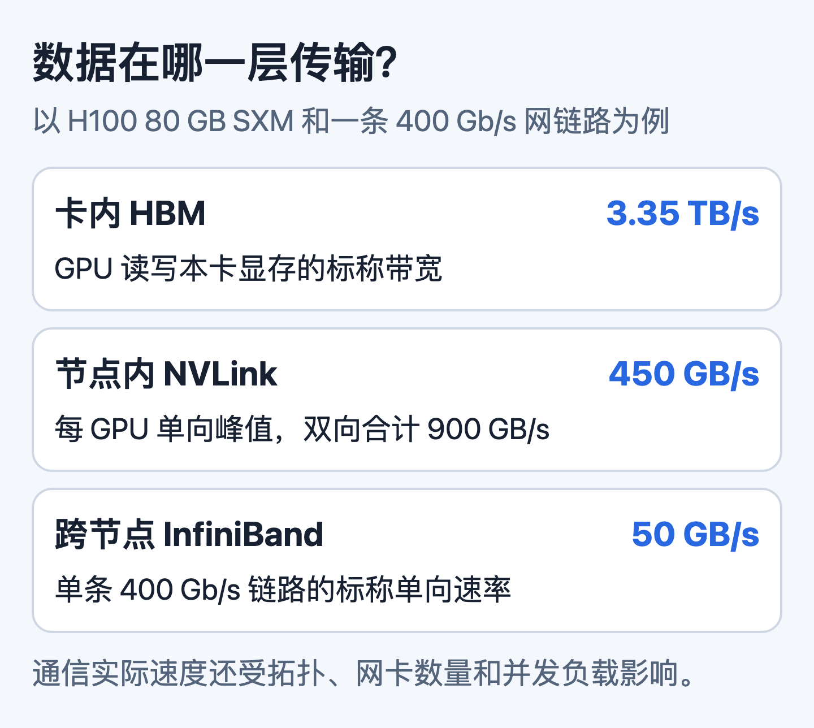
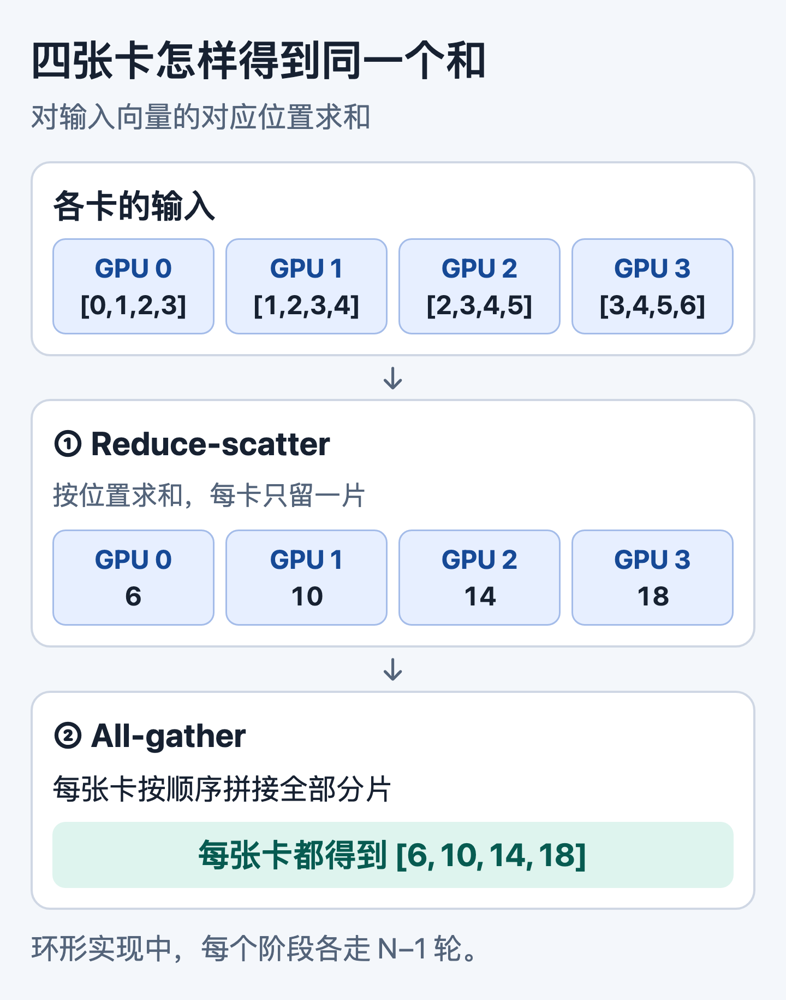
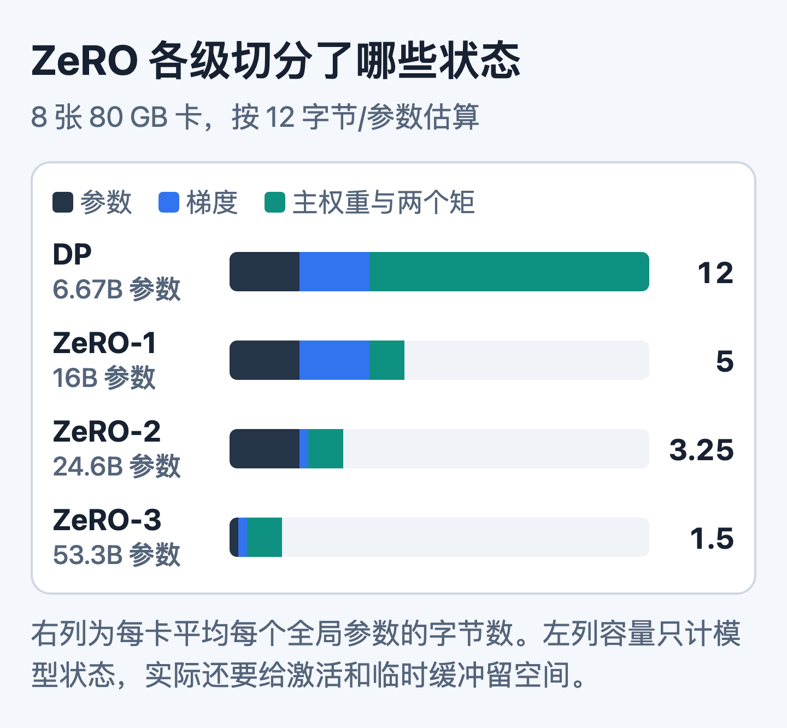
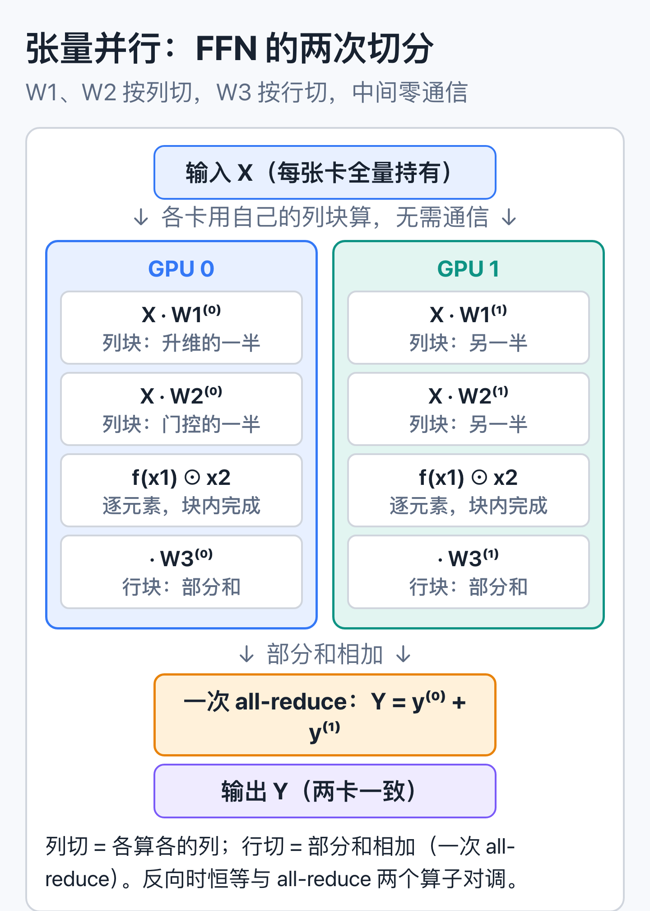
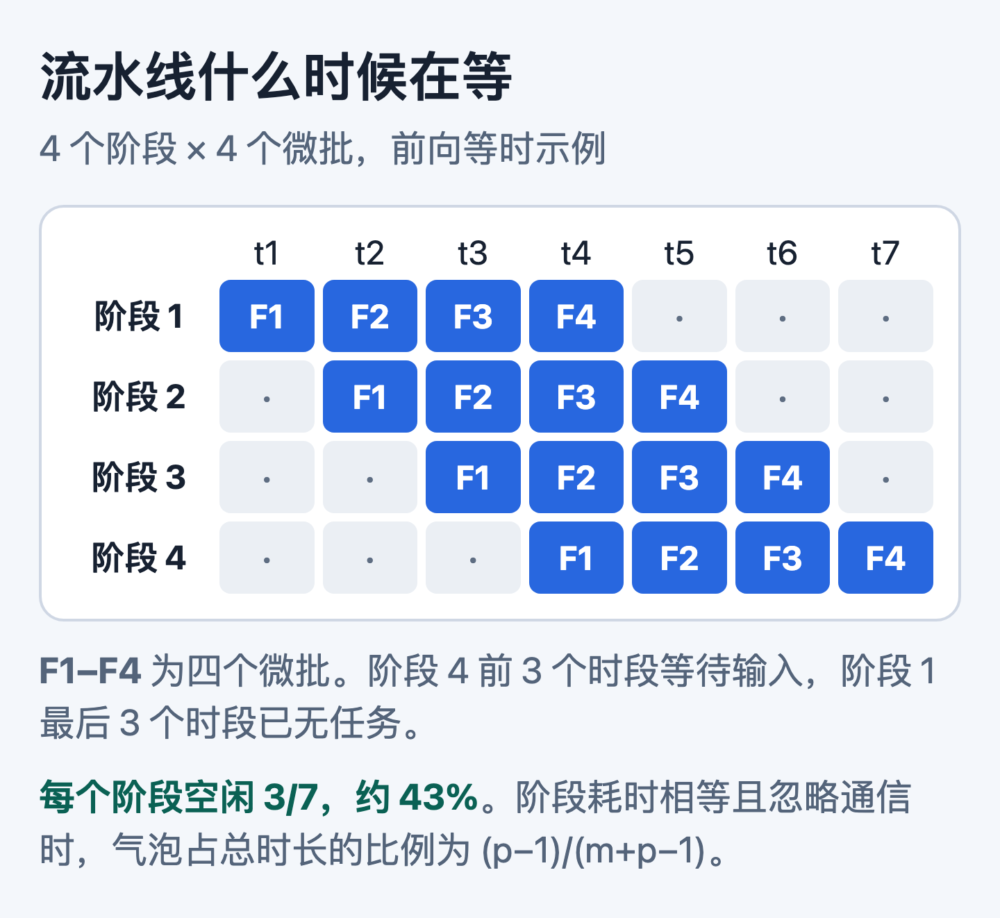
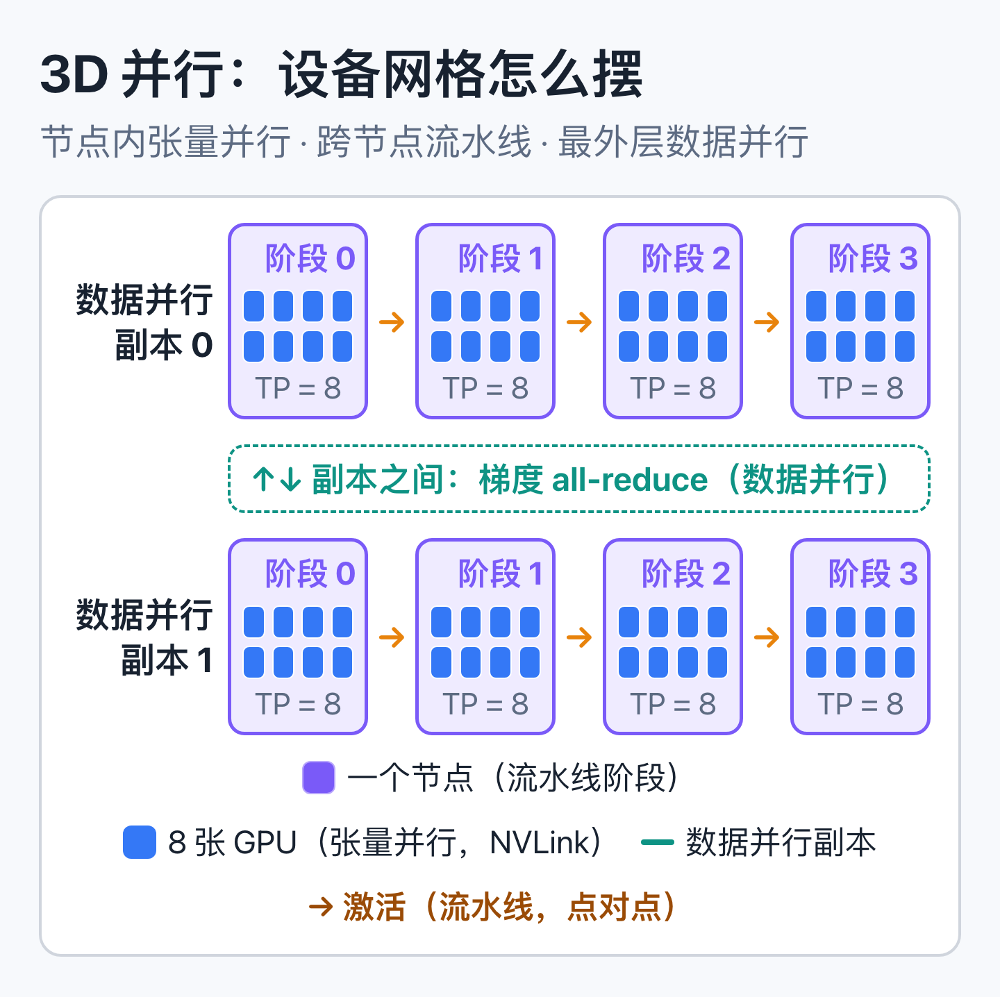

# 从一张卡到一个集群｜斯坦福 CS336 第 7–8 讲精读

> 原文首发于微信公众号「Wenyan的呜哇」。（发布后在上方补充「阅读原文」链接）

假设一张 GPU 有 80 GB 显存，而训练时，光是模型权重、梯度和优化器为更新权重保存的状态，就合计要占 100 GB。加了一张同样的卡，为什么还可能装不下？

这要看两张卡怎么分工。**普通数据并行**把训练样本分给两张卡处理，每张卡都用完整的模型。两张卡从相同的权重开始，各自计算梯度，再合并梯度并维护自己的更新记录。这样每张卡仍要为完整模型状态留出 100 GB，超过了单卡的 80 GB。要利用两张卡的总容量，可以让每张卡只存其中一部分，这叫**分片**。

还有一类数据叫**激活**，也就是模型处理样本时产生的中间结果。每张卡只会为自己处理的样本产生激活。同样是一次处理 8 条样本，两张卡各算 4 条，每张卡保留的激活通常就少一些。所以加卡能省多少显存，要看原来空间主要被什么占了。

第 5–6 讲讨论的是一张 GPU 内部怎样搬运数据。这一篇讨论数据在多张卡之间怎么传。遇到一种并行方式，可以依次问三个问题。

- **拆什么？** 是把样本分给不同卡，还是把模型的权重、更新记录或不同层分开？
- **传什么？** 各卡要交换梯度、权重，还是计算过程中的中间结果？
- **什么时候传？** 是在更新权重前汇总一次，还是每经过一层就要等其他卡的结果？

正文沿 2025 年 CS336 第 7–8 讲展开，配合作业 2 的例子。可以先读各卡怎么分工，具体通信量的推导放在文末。

## 一、为什么一张卡不够

### 训练时到底在存什么

先看**一个训练步**。模型读入一批样本，给出预测，再计算预测偏差有多大，这一步叫**前向传播**，用来衡量偏差的数值叫**损失（loss）**。接着通过**反向传播**计算损失对每个参数的梯度，也就是“把某个参数稍微改动一点，损失会怎样变化”。最后由**优化器**根据梯度更新参数。一次更新要用到的这批样本，本文称为 **batch（批次）**。

显存里主要存着四类数据。

- **参数**是模型当前的权重，模型用它们来做预测。
- **梯度**是反向传播的结果，告诉优化器修改每个权重会怎样影响损失。
- **优化器状态**是为更新权重保存的记录。比如 AdamW 会保存两个量，分别记录近期梯度的平均值和梯度平方的平均值。有些实现还会额外保留一份精度更高的**主权重**，用它累积小幅更新。
- **激活**是前向的中间结果。各层前向算完后，一些中间结果还要留着，反向传播轮到这一层时会再用上。

以一种混合精度 AdamW 实现为例，参数和梯度用 **bf16**，每个数占 2 字节。主权重和优化器的两项记录用 **fp32**，每个数占 4 字节。这里的 bf16 和 fp32 是两种浮点数格式，先记住它们在这笔账里分别占几字节就够了。

这样，每个参数连同对应的梯度和更新记录，总共需要 **2+2+4+4+4=16 字节**。70B（700 亿）参数约需 **1.12 TB**，还没算激活和临时空间。各实现用的精度和存储方式可能不同，所以 16 字节是一种估算口径。

这决定了单卡能不能装下模型。即使装得下，训练时间也可能太长。多卡可以分摊计算，但各卡有时要停下来等待通信，所以还要把通信开销算进去。

### 带宽阶梯｜传到哪里，花费不同

一台装有多张 GPU 的服务器通常叫一个**节点**。**带宽**表示一秒钟能传多少数据。图 1 举了三个例子，从上到下分别对应三条路径。

- **卡内**。GPU 读写自己的显存。以 H100 80 GB SXM 为例，卡内的高带宽显存叫 HBM，图中的标称值是 3.35 TB/s。
- **节点内**。同一台服务器上的 GPU 可以通过 NVLink 等高速连接交换数据。这款 H100 的 NVLink 标称 900 GB/s 是双向合计带宽，估算只往一个方向发送的速度时约为 450 GB/s。
- **跨节点**。数据要经过两台服务器的网卡和集群网络。以单条 400 Gb/s InfiniBand 链路为例，换算后是单向 50 GB/s。网络配置不同，每张卡实际可用的带宽也会变。

发送同样的 1 GB，只按图里的两条单向速率算，节点内约需 2.2 ms，跨节点约需 20 ms。还有一项开销是**通信延迟**，也就是启动传输到数据开始到达的等待。这就是为什么有些并行方法适合在同一台服务器里用，有些则更适合把工作分到不同服务器。

## 二、多卡之间怎么通信｜先掌握 all-reduce

用两张卡处理一批数据时，两张卡各算出一份梯度。如果各自只按自己的梯度更新，模型权重就会变得不同。为了让两张卡继续训练同一个模型，先把两份梯度按对应位置合并，再把结果交给两张卡。

让一组进程共同完成数据交换，叫**集合通信**。这一组进程叫**通信组**，组内有多少进程用 **world size** 表示，每个进程的编号叫 **rank**。课程里通常一个进程负责一张卡，可以先把它们理解成组内卡数和卡号。

**All-reduce（全归约）** 就是先合并，再让所有参与者都得到完整结果。例如两卡分别算出 [1,2] 和 [3,4]，按位置相加后，两卡都得到 [4,6]。这里的“归约”指把多份数据对应位置的值合成一个值，求和只是其中一种做法。

可以把这个过程拆成两步。

1. **Reduce-scatter（归约再分片）**。按位置求和后，卡 0 只留第一项 4，卡 1 只留第二项 6。
2. **All-gather（收集并拼接）**。两张卡互相交换手里的结果，各自把 4 和 6 按顺序拼起来。

图 2 把同样的过程扩展到四张卡。第一列是 0+1+2+3=6，其他列同理。先每卡留一个数，再拼出完整的 [6,10,14,18]。

其他几个词也可以按“谁发、谁收”来记。**Broadcast（广播）** 是一张卡给所有卡发同一份。**Scatter（分发）** 是一张卡给不同卡发不同的一片。**Gather（收集）** 是把各卡手里的片段收集到指定的一张卡。

### 卡数增加，通信量怎么变

课上用**环形算法**估算。可以想象每张卡都有一个固定的下一站，把数据拆成小片，每轮向下一张卡传一片，同时从上一张卡接一片。第一阶段经过多轮交换，把各片的和算好。第二阶段再经过多轮交换，让每张卡收齐所有片段。

以四卡为例，完整数据分四片。每个阶段需要三轮，每卡每轮发送一片。每卡两个阶段共发送六片，相当于完整数据的 **1.5 倍**。一般情况下，卡数增多时，轮数增加，但每片也变小，所以每卡发送量接近完整数据的两倍。环形算法的公式和课上实测放在进阶部分。

## 三、数据并行与 ZeRO｜从复制模型到切分状态

### 数据并行｜每张卡保留完整模型，只切数据

普通数据并行（Data Parallelism，简称 **DP**）可以分成四步。假设这一批有 8 条等长样本，两张卡各拿 4 条。

1. **分数据。** 本次更新一共处理 8 条样本，叫**全局 batch**。每张卡处理的 4 条，叫这张卡的**本地 batch**。
2. **各卡计算。** 两卡用相同的权重做前向和反向，各自生成激活，算出反映自己这 4 条样本的梯度。
3. **合并梯度。** 用 all-reduce 把各卡的平均梯度加起来，再除以卡数，得到全局平均梯度。这个例子假设两张卡各处理相同数量的有效数据。
4. **各卡更新。** 两张卡用同一份平均梯度更新各自持有的模型。只要起始权重、优化器状态和更新规则一致，更新后的权重也会保持一致。

课上看到各卡的 loss 不同很正常，因为它们处理了不同的样本。需要保持一致的是更新步使用的梯度和更新结果。语言模型也常按 token（模型读入的文本单位）平均损失。如果两卡的有效 token 数分别是 100 和 50，要让每个 token 的权重相同，就按 100∶50 合并两卡的平均梯度。

给数据并行记三笔账。

- **计算**。两张卡可以同时处理各自的 4 条样本。速度能提高多少，还要看计算、通信和每卡工作量。
- **显存**。每卡处理的样本少了，激活通常会变少。整套参数、梯度和优化器状态仍占每张卡的空间。
- **通信**。每次更新前要合并这一步的梯度。常用的 PyTorch **DDP（分布式数据并行）**会把多个参数的梯度凑成一组，叫一个**桶**。哪一桶先算完，就可以先发哪一桶。

如果各卡处理的样本数一样，全局 batch 等于数据并行卡数乘以本地 batch。固定全局 batch 加卡，每卡分到的样本越来越少。固定本地 batch 加卡，总 batch 则会变大，相当于改变了每次更新用到的数据量。

### ZeRO｜先把重复的存储切开

普通数据并行中，两张卡会用相同的梯度做相同的更新，于是两边都保存了一套优化器状态。**ZeRO** 的思路是把这些重复的数据分开保留。下面还是用两张卡来理解。

**ZeRO-1 切优化器状态。** 将模型参数分成前、后两半，分别交给卡 0、卡 1 负责更新。训练到更新这一步时，可以这样做。

1. 两卡各用完整模型跑前向和反向，各自算出针对整套权重的局部梯度。
2. 用 reduce-scatter 把两卡算出的梯度合起来，卡 0 拿汇总结果的前半，卡 1 拿后半。
3. 每张卡用自己保存的优化器状态，更新自己负责的权重。
4. 两卡用 all-gather 交换**更新后的权重**，各自拼回完整模型，准备下一步。

这样，计算前向需要的权重仍各有一整份，优化器记录却各只留一半。第二步传梯度，第四步交换的是新的权重。

**ZeRO-2 继续切梯度。** 反向传播通常逐层算梯度。哪一层算完，就可以把它的梯度合并并交给负责相应权重的卡。用过的临时梯度释放掉，无需在一张卡上保存所有层的完整梯度。

**ZeRO-3 继续切权重。** 平时各卡也只留权重的一片。比如轮到第 5 层时，两卡先交换第 5 层的权重分片，临时拼齐这一层，再各算各的样本。前向算完后如果释放了拼出的权重，反向算到该层时就再收集一次。梯度算完后，再按分片汇总。**FSDP（全分片数据并行）** 是 PyTorch 里的实现方式，配置成完全分片时，参数、梯度和优化器状态都会按这个思路切分。

若权重与梯度传输的字节数相同，每卡发送量可以粗略记成 **2∶2∶3**。普通 DP 的一次梯度 all-reduce，可以看成“归约再分片”加上“收集完整梯度”。上面这种 ZeRO-1/2 是“归约再分片”，接着收集更新后的权重。全分片若在反向重新收集权重，则是前向收集权重、反向再收集权重、归约并分发梯度。公式和精度不同的情况放在文末。

### 八张 80 GB 卡，分片后省了多少

第 7 讲用另一种精度方案估算。权重和梯度各占 2 字节，优化器的两项记录和主权重合计 8 字节，每个参数共占 **12 字节**。图 3 对比的是这套存储方案。

拿 ZeRO-2 举例。每卡仍保存整套权重，所以每个参数的 2 字节照付。剩下的梯度和更新记录合计 10 字节，由 8 张卡分摊，平均下来每卡为每个全局参数承担 **2+10÷8=3.25 字节**。80 GB 除以 3.25，约能容纳 24.6B（246 亿）参数对应的这些状态。实际训练还要给激活和临时空间留显存。

### FSDP 多传了权重，为什么仍可能很快

如果 GPU 算完第 5 层才开始收集第 6 层权重，它就得等。**预取**是提前发起通信，比如还在算第 5 层时，就开始收集第 6 层权重。如果第 5 层算完时权重已经到齐，这次传输就和计算**重叠**了。反过来，太早准备好后面几层会占用更多显存，需要平衡。

作业 2 依次练习普通数据并行、优化器状态分片和全分片。可以先对照单卡检查更新结果，再测每步耗时和显存峰值。这样能分别看出分片省了多少显存，以及增加的传输有没有拖慢训练。

## 四、张量并行｜把一层里的矩阵切开

普通数据并行让两张卡拿同一套权重，算不同的样本。**张量并行（Tensor Parallelism，TP）** 让两张卡拿不同的权重片段，算同一批样本。大模型的每一层有很多矩阵乘法，这一节先看怎么把一个矩阵乘法拆给两张卡。

### 列切和行切

设某一层在做 **Y=XW**。X 是输入，W 是权重矩阵，Y 是输出。每个输入位置有一组数字，叫**特征**。假设 X 只有两个数 [2,5]，一组输出权重是 [3,7]，另一组是 [4,8]。完整结果有两个数，分别是 2×3+5×7=41 和 2×4+5×8=48。

- **按列切权重**，把两组输出权重分别给两张卡。两卡都看到 [2,5]，第一张算出 41，第二张算出 48。如果之后要完整输出，用 all-gather 拼成 [41,48]。
- **按行切权重**，把有关输入 2 的权重交给第一张卡，有关输入 5 的权重交给第二张卡。第一张对两个输出分别算出 [6,8]，第二张算出 [35,40]。每张卡拿到的是**部分和**，即对最终结果的一部分贡献。两份数按位置相加才得到 [41,48]。如果两卡都要完整输出，就做 all-reduce。

这里的行和列按公式 Y=XW 来说。有的框架把矩阵转置存放，读实现时可以看切掉的是输入特征还是输出特征。

### 为什么 FFN 可以先列切，再行切

**FFN（前馈网络）** 是 Transformer 层里处理各 token 特征的一组运算。它先将每个 token 的特征变多（**升维**），再把特征变回原来的数量（**降维**）。图 4 画的是门控版本。门控就是让两条分支在对应位置相乘，一条分支参与决定另一条分支的值保留多少。

第一步将两条升维分支都按相同方式列切。每张卡手里的特征都有同位置的两个值，可以自己完成门控。第二步将降维矩阵按行切，各卡用刚算好的那组特征计算部分和。到输出时才把两边加起来，FFN 前向共做一次 all-reduce。

反向时，两边算出的输入梯度也是部分和，需要再合并一次。用这种切法，FFN 的前向和反向各有一次 all-reduce。注意力子层也可以按头分给不同的卡，输出投影处有类似的合并。

### 为什么张量并行常放在节点内

数据并行主要在反向汇总梯度。张量并行在许多层的前向和反向都要合并结果，而且合并完才能继续下一段计算。因此，TP 组通常选同一台服务器里连接较快的卡，例如通过 NVLink 互连的卡。把组开得多大，还要看切小后的矩阵能不能算得快，以及各卡等待结果的时间。

## 五、流水线并行｜把模型分成几段

例如，一个模型有 34 层，前 17 层放在卡 A，后 17 层放在卡 B。每张卡只需要保存自己负责的层的权重和更新记录，这叫**流水线并行（Pipeline Parallelism，PP）**。

前向时，A 把第 17 层的输出发给 B，B 接着算后面的层。反向时，B 要把相对于这个输出的梯度发回 A，A 才能继续往前算。这是两张卡之间的**点对点通信**，也就是从一个发送方传给一个接收方。发送发生在两段相接的地方，在一张卡上的层之间可以直接传递结果。

### 直接切层，为什么会有卡在等

如果把 8 条样本当一组处理，B 必须等 A 算完这一组，才能开始前向。B 在算的时候，A 又没有这批样本的后续工作。这些等待时段叫**气泡（bubble）**。

现在把 8 条分成四组，每组 2 条。这种小组叫**微批（micro-batch）**。A 算完第一组，就可以交给 B，同时开始算第二组。这样，多张卡可以在同一时刻处理不同微批。

图里扩展到了四个阶段。看第一行，阶段 1 算了 4 个时段，后来空闲了 3 个时段。看最后一行，阶段 4 空闲在开头，因为要等第一组数据经过前面三段。按任意一行看，7 个时段里有 3 个灰格，所以这个算例的空闲占比是 **3÷7，约 43%**。

在各阶段耗时相等、忽略通信的前向模型里，空闲时间来自开头等待输入或末尾没有工作。还是四个阶段，微批数增至 16 时，每个阶段仍空闲 3 格，但总时长变成 19 格，气泡占比降到约 16%。64 个微批时，气泡占比进一步降到约 4.5%。实际还可以交替安排前向和反向，让一些激活更早释放，效果取决于各段的计算与通信时间。

### 微批多了，一次更新用的样本数也会更多吗

刚才的 8 条拆成四次算，将四份微批平均梯度取平均后再更新，仍然用的是原来 8 条。这叫**梯度累积**。如果每个微批固定为 2 条，把累积次数从 4 增到 8，一次更新才会用 16 条。这时改变了有效 batch，也就是一次实际参数更新使用的样本数。

流水线并行利用多个微批填补等候时间。普通数据并行也可以用梯度累积，先各卡本地累积，最后一个微批再同步，从而减少同步次数。沿样本拆分时，一次更新只有 2 条样本，最多只能切出 2 个非空微批。

### 为什么流水线可以跨节点

TP 常在每层内部交换计算结果。PP 只在阶段的交界处传，前向发中间结果，反向发相应的梯度。比如一个阶段里有 17 层，只需把阶段最后一层的输出发给下一台服务器，反向时再收回对应梯度。PP 因此常用来跨节点切层，实际还得看各阶段是否均衡，以及有没有足够多的微批来减少等候。

## 六、把方法拼起来｜3D 并行与真实训练

### 64 张卡怎么分工

把张量并行、流水线并行和数据并行放到同一个集群里，就是 **3D 并行**。这里的“三维”指三种不同的分工。图 6 有 8 台服务器，每台 8 张卡。

可以按图从小到大看。

1. **看一个紫框。** 它是一台服务器，里面 8 张卡共同计算同一组层。这里用的是张量并行。
2. **看横着一排。** 4 台服务器各负责一段，共同组成一份完整模型。前向把激活向右传，反向把相应梯度向左传。这里用的是流水线并行。
3. **看上下两排。** 两份完整模型分别处理不同样本。同一段、同一块权重在两份模型里各有一份，例如每排阶段 0 的第 3 张卡，和另一排同一位置的卡合并梯度。这里用的是数据并行。

64 张卡中，每排 32 张协作处理这排的数据，所以只有两份数据并行副本。**全局 batch 是两份副本处理的样本数相加。** 如果两排都处理 8 条样本，一次更新就用 16 条。

### 模型装下了，为什么还要算激活

各层前向时，不少结果要一直保留到反向。序列越长，这部分通常越大。比如朴素注意力会为 token 两两打分。100 个 token 有 1 万个分数位置，200 个 token 就有 4 万个。模型权重没有增加，中间结果却能明显变大。

第 7 讲讨论了三种节省办法。

- **选择性重算**。保留重算所需的信息，反向时再恢复部分中间结果。第 5–6 讲的 FlashAttention 还把分数分块算，避免整张分数表写回显存。
- **张量并行**。让不同卡算不同特征，有些中间结果也能跟着特征分开保存。
- **序列并行**。某些操作可以逐个 token 独立处理，例如 LayerNorm 可以分别调整每个 token 的特征。可以让一张卡算前半段 token，另一张卡算后半段，减少重复保存。碰到需要完整输入的操作时再把数据收齐。

序列并行和**上下文并行**都可能沿 token 切。这里说的序列并行用来节省部分逐 token 操作的激活。上下文并行还会切开注意力计算，负责不同片段的卡需要交换注意力用到的信息。激活的具体用量推导在文末。

### 实际训练会先解决最紧的限制

模型状态装不下，可以先考虑 ZeRO 或 FSDP，也可以把层内矩阵或模型的不同层切开。把需要频繁归约的张量并行组放在高速互联内，流水线则可以在服务器之间切段。容量问题解决之后，还可以增加数据并行副本处理更多数据，效果取决于每卡的工作量和通信时间。

课件列了不同做法。OLMo 7B 用 FSDP 减少重复存储。Llama 3 405B 组合多种并行，训练更长的序列时增加了上下文并行。DeepSeek-V3 用 16 路流水线、64 路专家并行和 ZeRO-1。**专家并行**分配的是 MoE 模型里的不同子网络，模型会为 token 选择要去的子网络，因此设备之间还要传 token。Yi 结合了张量并行、流水线并行和优化器状态分片。Gemma 2 则在 TPU 上结合模型分片和类似 ZeRO-3 的技术。这些选择来自各自的模型结构和集群条件。

### 回到作业 2 的两张 B200

Spring 2026 作业的排行榜用两张 B200 训练约 8B 参数的模型，每步处理两条序列，每条长 32768 个 token。计时包括前向、计算损失、反向和 AdamW 更新。

按前面的 16 字节估算，8B 模型的参数相关状态大约占 **128 GB**。再看模型最后一步预测。它给每个 token 对词表中每个候选项打分，这些分数叫 **logits**。两条序列各有 32768 个位置，词表约 15 万项。如果同时把所有分数保存成 bf16，仅这一个张量就约 **19.9 GB**。

两类负担可以分别处理。状态分片能少存参数、梯度和更新记录。FlashAttention 和激活检查点可以少存中间结果，检查点的做法是保留少量信息，反向时再算出需要的结果。把每组预测分数算出来之后直接用来计算损失，也可以省掉完整的分数表。作业固定了同一批数据的大小，可以在相同条件下比较训练结果、峰值显存和整步时间。

## 进阶推导｜想算细一点时再读

### 集合通信与 ZeRO 的每卡发送量

设 N 张卡参与，完整张量大小为 S 字节。记 k=(N−1)/N。环形算法中，每一阶段走 N−1 轮，每轮每张卡发送 S/N 字节。所以一次 reduce-scatter 或 all-gather 每卡发出 kS，完整 all-reduce 每卡发出 **2kS**。这里按发送量统计，接收是另一笔同样大小的量。

课上公开记录里，四卡对 400 MiB 的 fp32 张量做 all-reduce，用时约 2.11–2.16 ms。按同样的环形等效流量折算，带宽约 291–298 GB/s。实际实现会根据消息大小和网络结构选择算法。

令完整权重和梯度在网络上传输时的大小分别为 P 和 G 字节。在上述环形模型里：

- 普通 DP 的梯度全归约是 **2kG**。
- 文中 ZeRO-1/2 流程的梯度归约和更新后权重收集是 **k(G+P)**。
- 反向需要再收集一次权重的全分片流程是 **k(G+2P)**。

P 和 G 相等时得到 2∶2∶3。如果权重以 bf16 发送、梯度以 fp32 发送，G 就是 P 的两倍，比例也会变。即使总字节数相同，通信是否阻塞计算仍取决于它发生的时机。

### 流水线的通信与激活用量

如果每个微批有 b 条序列，每条 s 个 token，每个位置有 h 个特征，那么相邻阶段之间的激活共有 b×s×h 个元素。前向发一次激活，反向发一次对应梯度。两者都用 bf16、大小相同时，每微批在一条边界共传 **4bsh 字节**。在各阶段等时、暂不计通信的前向模型里，p 个阶段、m 个微批的气泡占总时长 **(p−1)/(m+p−1)**。课件以有效计算时间为分母时，写作 (p−1)/m。

Korthikanti 等人的论文给出一种 Transformer 实现的激活账本。设 a 是注意力头数，单层完整保存的激活约占 **34sbh + 5abs² 字节**。二次项对应注意力中随序列长度平方增长的中间结果。去掉二次项后，24sbh 可用张量并行分摊，10sbh 可进一步用序列并行分摊。公式里的系数会随模型和实现变化。

### 什么时候通信可能比计算更慢

作业 2 用门控 FFN 比较 DP、FSDP 和 TP。用同一套口径，可以看出 token 数和网络带宽分别怎样改变三个方案的临界点。设 B 是进入 FFN 的 token 行数，h 为隐藏宽度，DFF 为升维宽度，N 为并行组卡数。C 是单卡计算吞吐（FLOP/s），W 是单卡单向发送带宽（字节/s）。假定通信张量每元素 2 字节，三个矩阵共有 M=3h×DFF 个权重。先忽略逐元素运算、启动延迟和拓扑竞争。

**DP 看反向。** 每卡处理 B/N 行。三个矩阵合起来，前向计算量约为 2BM/N，反向约为前向的两倍，所以每卡反向计算时间约为 4BM/(NC)。三个矩阵的梯度共有 2M 字节，all-reduce 的每卡发送量约为 2k·2M=4(N−1)M/N，对应时间约为 4(N−1)M/(NW)。令通信时间小于计算时间，可得 **N < 1 + B×W/C**。在这个估算里，更大的全局 batch 能提供更多计算来摊薄通信。

**TP 看前向。** 每卡承担约 1/N 的矩阵计算，时间约为 2BM/(NC)。FFN 末尾归约 B×h 个元素，时间约为 4(N−1)Bh/(NW)，可得 **N < 1 + 1.5×DFF×W/C**。B 在两边约掉了，因为增加 token 会同时增加算量和激活通信量。

**FSDP 也可按前向和反向分别估算。** 如果前向用 all-gather 收集本层参数，它的计算时间约为 2BM/(NC)，通信时间约为 2(N−1)M/(NW)。代入同样的比较，临界条件写起来与 DP 的反向相同，但通信发生在不同阶段。FSDP 若能在前一层计算期间完成预取，当前层就可以直接开始。

取 H100 稠密 bf16 峰值约 989.5 TFLOP/s、DFF=11008。若 W 取 450 GB/s，TP 前向不等式右侧约为 **8.51**。若按每卡可用 50 GB/s 估算，右侧约为 **1.83**。这两个数比较的是理想时间。实际还要测矩阵吞吐和通信带宽，并从时间轴确认归约是否挡住了后续计算。以经典 TP 为例，若某个 Transformer 块的注意力和 FFN 都各做一次前向、一次反向 all-reduce，每卡发送量约为 8kS，其中 k=(N−1)/N，S 是一个全宽激活张量的字节数。流水线在单一边界的双向传输是 2S，还要结合阶段内层数和跨节点路径来比较。

## 追问｜换一个条件，还会判断吗？

### 1. 加一张卡，哪些显存会少，哪些仍要存整份？

普通数据并行只分样本，每卡样本少了，它自己产生的激活通常也会少。每卡仍持有整套权重、梯度和优化器状态。如果光这三样就超过单卡显存，要考虑分片。回看开头的 80 GB 和 100 GB 算例。

### 2. FSDP 用 bf16 收集参数，两种方案都用 fp32 传梯度，发送量还差 1.5 倍吗？

此时梯度 G 是参数 P 的两倍。代入进阶部分的通信公式，FSDP 的 k(G+2P) 等于 DP 的 2kG。即使发送字节相同，分层收集参数与梯度同步出现在不同位置，停等时间也可能不同。回看进阶部分对发送量的比较。

### 3. 两个全分片实现常驻状态一样，为什么一个更容易显存不足？

预取下一层时，当前层参数、下一层参数和激活可能同时驻留。要比较两者的峰值，还得看此时各留了多少完整参数。回看第三节的释放与预取。

### 4. FFN 的两个升维分支把对应特征分到了不同卡，门控还能在各卡独立完成吗？

门控乘法要拿到同一特征位置的两个值。两支分片位置不一致，就要重新排布或通信。两个升维矩阵采用同样的列切规则，中间结果才可以一直保持分片。回看图 4。

### 5. 一份四阶段流水线每步只有四个样本，可以切出 64 个微批吗？

沿样本维最多能得到四个非空微批。若通过增加样本数来得到更多微批，有效 batch 也随之改变。回看第五节，区分把既定 batch 拆小与增加一次更新处理的样本数。

### 6. 64 张卡中，哪些卡该同步同一块权重的梯度？

先确定该权重属于哪个流水线阶段和哪个 TP 分片，再找到各数据并行副本上的对应卡。这些卡持有相同的权重分片，计算来自不同样本的局部梯度。回看图 6，沿图中的上下方向找对应位置。

## 主要参考资料

- Stanford CS336《Language Modeling from Scratch》，Spring 2025，第 7–8 讲《Parallelism》。第 8 讲可执行讲义文件名为 lecture_08.py。
- Stanford CS336 Assignment 2《Systems and Parallelism》，Spring 2026。并行通信推导见第 8 节，完整训练步排行榜见第 9 节。
- NVIDIA《H100 Tensor Core GPU》规格、NCCL《Collective Operations》文档及 NCCL Tests《Performance》。
- Rajbhandari 等，《ZeRO: Memory Optimizations Toward Training Trillion Parameter Models》。Zhao 等，《PyTorch FSDP: Experiences on Scaling Fully Sharded Data Parallel》。
- Shoeybi 等，《Megatron-LM: Training Multi-Billion Parameter Language Models Using Model Parallelism》。Narayanan 等，《Efficient Large-Scale Language Model Training on GPU Clusters Using Megatron-LM》。
- Huang 等，《GPipe: Efficient Training of Giant Neural Networks using Pipeline Parallelism》。Korthikanti 等，《Reducing Activation Recomputation in Large Transformer Models》。
- 模型报告《OLMo: Accelerating the Science of Language Models》《The Llama 3 Herd of Models》《DeepSeek-V3 Technical Report》《Yi: Open Foundation Models by 01.AI》《Gemma 2: Improving Open Language Models at a Practical Size》。
