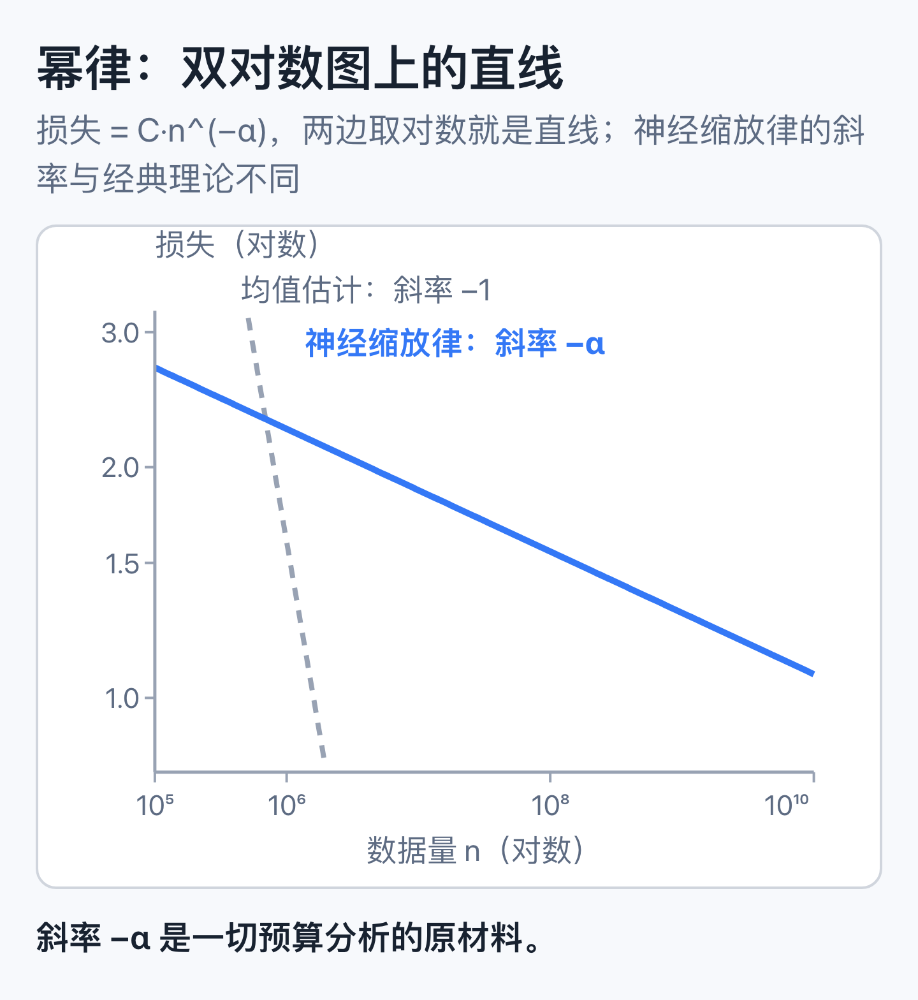
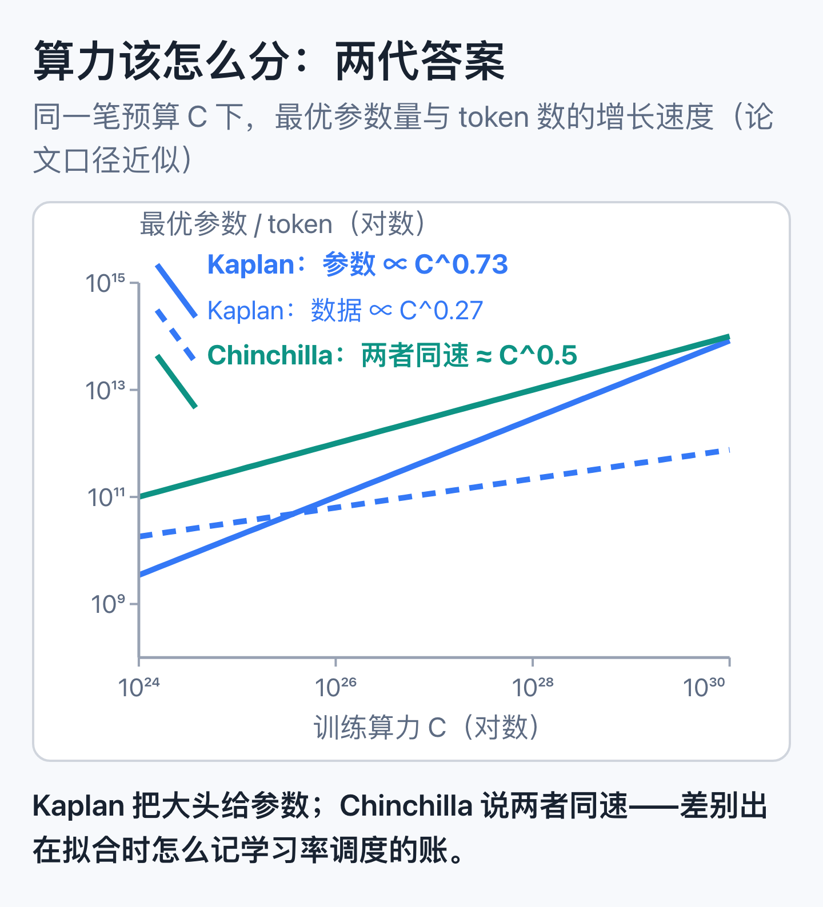
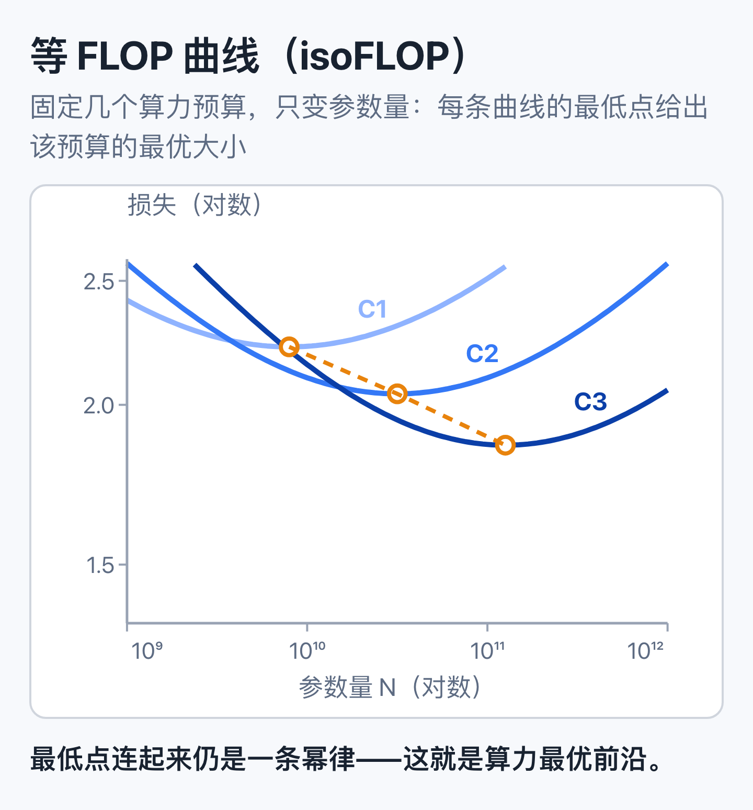
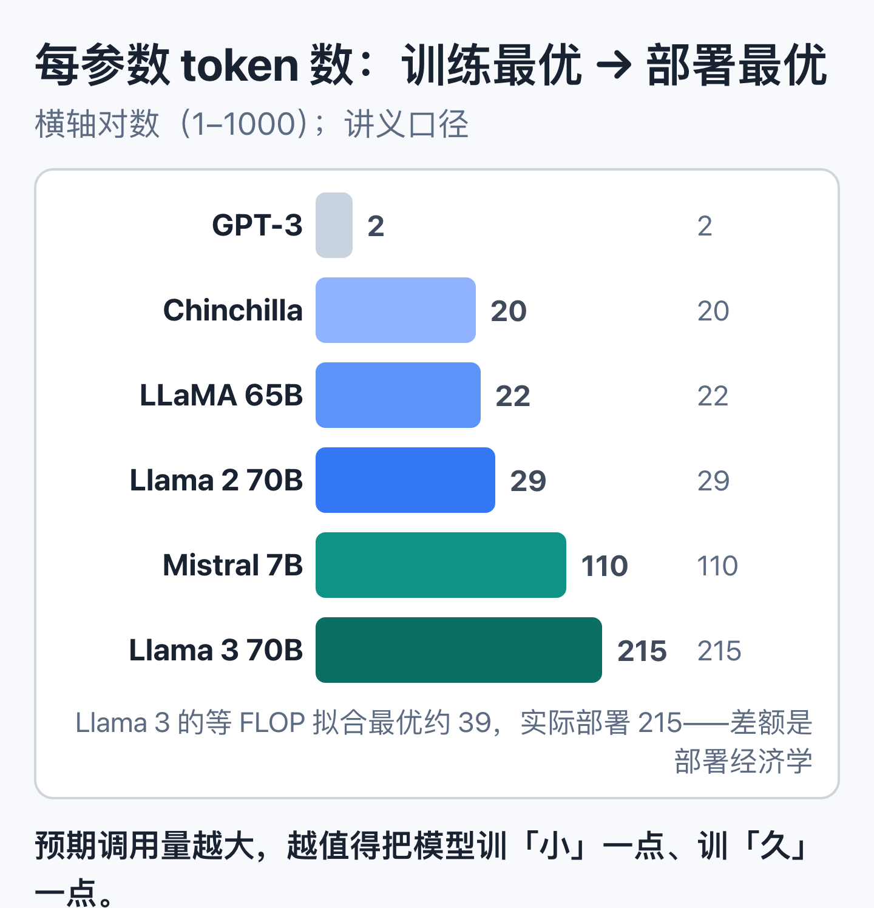
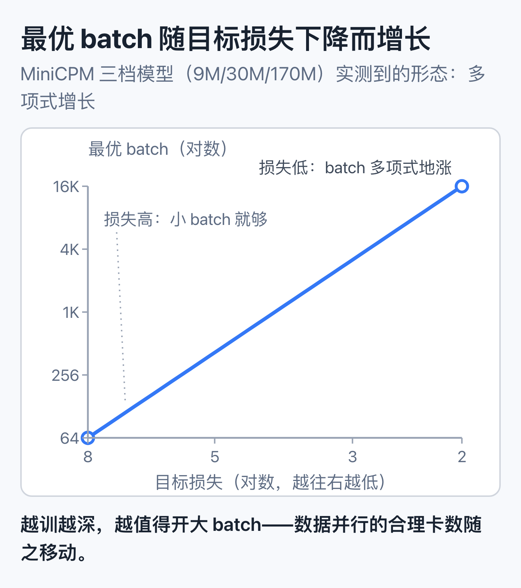
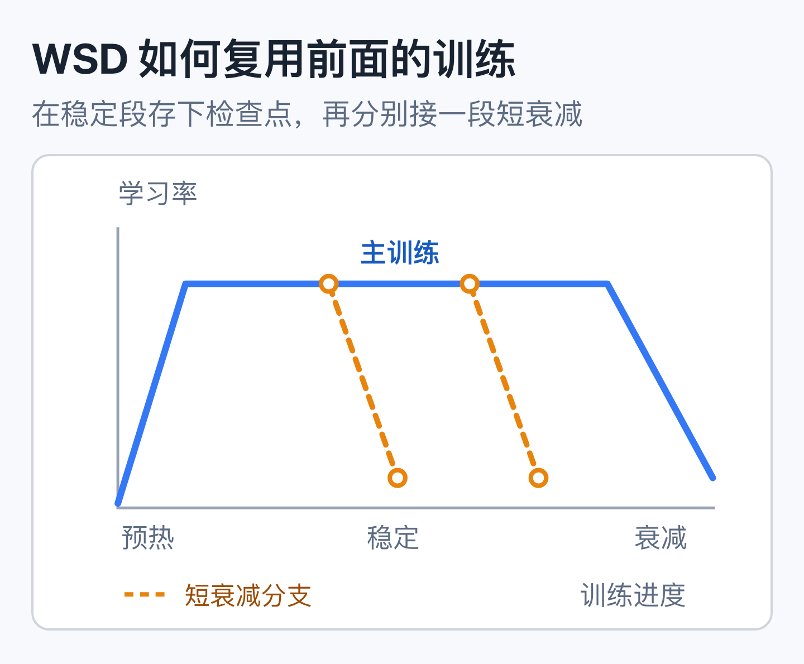

# 从幂律到算力最优：斯坦福 CS336 第 9、11 讲精读

> 原文首发于微信公众号「Wenyan的呜哇」。（发布后在上方补充「阅读原文」链接）

朋友借你一万张 H100，限期一个月，让你从头训练一个大语言模型。同样的算力，你会把模型做大，还是让它多读一些数据？

可以先粗算一笔。假设用的是 H100 SXM，训练时能用上约 40% 的 BF16 峰值算力，再按 Chinchilla 的经典配比来算，可以训练一个 **约 2900 亿参数（290B）的稠密模型，读约 5.8 万亿 token**。这是用一组假设算出的起点。换一批训练数据，或者把上线后的推理成本也算进去，最合适的模型大小就可能变。

斯坦福 CS336 第 9、11 讲讲的是怎么在正式开训前做这个决定。先跑一批成本较低的小模型，测清楚模型大小、数据量与损失的关系，再把结果外推到大模型。

读这一篇，只需要先认识五个词：

- **参数量 N**：模型里可以被调整的权重个数，通常用 B（十亿）来计数。
- **训练 token 数 D**：训练过程中模型实际读过的文本片段总数。
- **损失（loss）**：模型预测下一个 token 的偏差程度，越低越好。
- **训练算力 C ≈ 6ND**：把模型训一遍大致需要的浮点运算量，后文会反复用它算账。
- **MFU**：模型算力利用率，实际用上的算力占硬件峰值算力的比例。第三节会用它重算开头的账。

## 一、缩放律：小模型能告诉我们什么？

想象你训练了几组同样大小的模型，每组用的数据是前一组的两倍。模型读的文本越多，预测下一个 token 的平均损失往往越低。**数据再翻一倍，损失还能降多少？**

在一定范围内，答案可以用幂律近似。比如假如损失超出下限的部分与数据量的 −0.1 次方成正比，那么数据每翻一倍，这部分就会降到原来的约 93%。只要这样的比例关系能维持，把横轴的数据量和纵轴的超额损失都取对数，就会看到一条近似直线。斜率告诉你继续加数据的回报有多大。这里的 −0.1 只是为了演示怎么读幂律（Kaplan 等，2020）。

### 一条能自己算出来的幂律

假设你想知道一座城市某天的平均用电量，随机抽取 n 户，拿这 n 户的平均值当估计。把每户的波动记为方差 σ^2，在样本独立、来自同一分布的理想化条件下，**样本均值的均方误差就是 σ^2 / n**。因此，样本翻倍，均方误差减半。两边取对数，斜率就是 −1。图 1 里的灰线画的是这个关系。

语言模型也能测出类似的关系，但下降速度通常慢得多。上面的 −0.1 例子里，数据翻倍只让超额损失降约 7%。而且实际的学习曲线有不同阶段。Hestness 等人在多个任务里观察到，数据极少时模型可能接近瞎猜，中间一段幂律最明显，继续加数据后曲线又可能逐渐变平。做外推时，要先确认小模型测到的是哪一段（Hestness 等，2017）。

### 数据配方变了，曲线还管用吗？

两批数据可能在双对数图上画出两条斜率相近、位置不同的线。低的那条意味着同样多的数据能得到更低的损失。这种情况下，小模型已经能帮你筛掉较差的数据配方。Hashimoto 在多数据源实验中研究过这种现象。换一类数据或评估任务时，可以重新测几档规模，看看斜率和曲线的相对位置是否还稳定（Hashimoto，2021）。

还要区分**训练过程中读过多少 token**和**原始语料一轮有多少 token**。同一批数据读四轮，账面 token 数确实翻了四倍。Muennighoff 等人在数据有限、训练算力固定的实验中发现，累计训练约四轮以内，重复数据训出的损失与使用同等数量新数据的结果相近。继续重复时，新增一轮的收益会逐渐变小。这个结果取决于数据和训练条件（Muennighoff 等，2023）。

同样的办法也能比较架构。Kaplan 等人在小规模上得到的 Transformer 和 LSTM 损失曲线显示，两者的差距会随规模拉大。这里比较的是语言建模损失。Meta 想预测下游表现时，多做了两步。先用小模型估计模型会给正确答案多高的概率（用负对数似然衡量），再用已有模型的实测成绩拟合这个分数与任务准确率的关系（Kaplan 论文 §3.2；Llama 3 技术报告 §3.2.1）。

## 二、同一笔算力，模型和数据怎么分？

先看一条够用的近似式。对常见的稠密 Transformer，预训练计算量 **C ≈ 6 × 参数量 N × 训练 token 数 D**。预算固定时，参数量翻倍，能处理的 token 数就大约减半。所以「挑一个更大的模型」和「让模型多读一些数据」是同一笔账里的两个选择。

Kaplan 等人 2020 年的拟合偏向大模型。算力增加时，最优参数量大约按算力的 0.73 次方增长，最优 token 数按 0.27 次方增长。Chinchilla 在 2022 年得到的结果更均衡。**算力增加到约四倍时，最优参数量和 token 数都约翻一倍**。实际对照里，70B 的 Chinchilla 用和 280B 的 Gopher 近似相同的训练算力，多读了近五倍的数据，并在论文报告的多项评测中超过后者（Kaplan 等，2020；Chinchilla，2022）。

为什么结果会变？一个关键差别是**学习率在什么时候降下来**。Kaplan 的部分估计来自同一个长余弦调度的中途检查点。设想一条计划跑 100 步的曲线，到第 30 步时学习率可能还很高。专门安排一条 30 步的训练，让学习率在第 30 步前降下来，最终损失可能更低。Chinchilla 让调度长度跟各自的训练预算匹配，也在更大的模型尺寸上跑了更多实验（Kaplan 论文 §2.2；Chinchilla 论文 §2）。

### 看懂一张等 FLOP 图

挑一个小算力预算，用它训练几种大小的模型。小模型就多读点数据，大模型就少读点。等每组都训完，把横轴画成参数量、纵轴画成最终损失。**每条曲线的谷底，就是这笔预算下表现最好的参数量**。换几档算力预算，把这些谷底的位置拟合起来，就能估计预算更大时该选多大的模型。这就是等 FLOP（isoFLOP）分析。

### 另外两种方法怎样找最低点？

**下包络法。** 把不同尺寸、不同训练长度的运行结果画在同一张「算力—损失」图上。给定一笔算力，找到损失最低的点，记下赢家用了多少参数和 token。沿着图的下边缘找一遍，就能得到预算逐渐增大时的最优配置。

**联合拟合法。** 把所有实验点一起交给一个公式。Chinchilla 用的是 **L(N, D) ≈ E + A/N^α + B/D^β**。E 是模型和数据都继续增加时损失趋近的下限，第二项描述模型大小的限制，第三项描述训练 token 数的限制。A、B 和两个指数都由实验拟合。原论文在对数尺度上比较预测损失与实测损失，用 Huber 损失减弱离群点的影响。

这个公式也解释了为什么会出现「参数和数据同速涨」。固定算力时，多加一点参数，就得少读一点数据。如果两边的指数差不多，最优配比就会随算力近似保持稳定。**配比具体是 20 还是 40，还取决于拟合出的系数。** 后来，研究者从公开图表提取数据重新做了联合拟合，得到的结果与前两种方法相容（Chinchilla 论文 §3；Chinchilla 复现论文）。

第 9 讲还对比了自回归和扩散语言模型。研究者对两种模型都跑了等 FLOP 实验。两边都能找到各档预算下的谷底，得到的最优配置却不同。于是，哪怕换了训练架构，找配置的实验方法仍然用得上（Gulrajani 与 Hashimoto，2023）。

## 三、回到一万张卡：290B 是怎么算出来的？

H100 SXM 的密集 BF16 峰值约为每秒 989 万亿次浮点运算。一万张跑 30 天，理论上约有 **2.6 × 10^25 次浮点运算**。按 40% 的模型算力利用率（MFU）估算，模型训练可用的算力约为 **1.0 × 10^25 FLOPs**（NVIDIA H100 规格）。

接着代入 Chinchilla 的 **每个参数约配 20 个训练 token**。也就是 D ≈ 20N，所以上面的预算式变成 C ≈ 120N^2，开平方就得到开头的 **290B 参数、5.8 万亿 token**。

20 这个配比会随模型架构、训练数据和实验条件变化。用同一笔 H100 预算做个敏感度试算。如果自己的实验把配比定在 40 token/参数，预算式就变成 C ≈ 240N^2，按未舍入的 1.04 × 10^25 预算解出来约是 **210B 参数、8.3 万亿 token**。两种配置都能把算力花完，哪种损失更低要看实验曲线。

Meta 就为 Llama 3 单独做了这笔账。他们先用约 40M 到 16B 参数的模型跑等 FLOP 实验，再把曲线外推到约 3.8 × 10^25 FLOPs，估计应训约 402B 参数、用 16.55 万亿 token。最终旗舰是 405B，用了 15.6 万亿 token，折合每参数约 39 个 token（Llama 3 技术报告 §3.2.1）。

还有一笔账在模型上线之后。如果希望达到同样的质量，而且预计会有大量调用，**选一个更小的模型、多喂一些 token**，有时能省下整个生命周期的成本。多花的训练算力有机会靠更低的单次推理成本赚回来。值不值得做，取决于质量目标、调用量以及实际的推理成本（Sardana 等，Beyond Chinchilla-Optimal）。

## 四、小实验还要试 batch 和学习率

### batch 能开多大？

Batch size 是每次更新参数前一起处理的样本量，语言模型训练里也常用每步处理的 token 数来衡量。假设两档 batch 都远低于临界值，把每步的 token 数翻倍，达到同一损失所需的更新步数大致减半，**总共处理的 token 数基本不变**。硬件能并行消化更大的 batch 时，这就有机会缩短训练时间。

但 batch 大到一定程度，再翻倍，所需步数就很难再减半，总共处理的 token 反而会变多。**临界 batch** 大致标记了这个转折。Kaplan 把临界 batch 写成两个极限的比值，也就是用达到目标损失需要处理的最少样本数，除以能达到目标的最少更新步数。前一个极限在小 batch 一侧，后一个在大 batch 一侧（Kaplan 论文 §5.1）。

MiniCPM 实际做了一轮网格实验。他们用约 9M、30M、170M 三档小模型，每档试六种 batch。在同一训练 token 预算下，比较哪个 batch 的损失最低。把这些最优点画出来，就能看到在实验范围内，**目标损失越低，合适的 batch 往往越大**。这也接上了前一篇的数据并行：加卡能分摊每一步的工作量，最终能并行多少，还受全局 batch 的限制（MiniCPM 论文 §3.2 与附录 A.2）。

### 小模型调好的学习率，能搬到大模型吗？

模型加宽以后，即使填的是同一个学习率，各层激活在一次参数更新后的变化幅度也可能不同。**μP（最大更新参数化）** 会按模型宽度协调各层的初始化和学习率，让初始化时的激活、以及一次更新带来的激活变化，在加宽后仍保持合适的量级。这样，就更有机会把在小模型上调好的学习率设置迁移到大模型。可以迁移的是基础学习率这类设置，各层实际使用的学习率会随宽度按规则调整。以 Cerebras-GPT 的实现为例，隐藏层加宽两倍时，部分线性层权重的初始化方差和实际学习率会各减半。他们在 40M 参数的小模型上调基础超参，再迁移到最大 2.7B 的 μP 实验模型（μP 原论文；Cerebras-GPT 附录 G）。

DeepSeek LLM 走的是直接拟合路线。它把实测损失比当档最优值高不超过 0.25% 的配置都列为「近优」，再拟合学习率和 batch 随算力变化的趋势。这样，一次小实验里恰好拿到最低损失的那个点，就只是拟合用的众多样本之一（DeepSeek LLM 论文 §3.1）。

## 五、WSD：同一段训练，怎样多做几个实验？

假设同一个模型，你想看它读 100 亿、200 亿、300 亿 token 时各能做到什么水平。如果为每档长度单独安排余弦衰减，就得分别跑三次。直接取 300 亿那次的中途检查点，前两个点又可能还处在较高的学习率上。有没有办法把三次训练共同的开头省下来？

**WSD（预热—稳定—衰减）** 把学习率分成三段。先升到设定值，再保持一段时间，最后降下来。主训练先沿着稳定段往前跑。每到一个合适的检查点，就复制一份状态，另接一小段衰减，然后记录分支结束时的损失。主训练可以继续往前，为下一档预算留下检查点。

把刚才三档预算算一遍。假设每档最后一成做衰减，主线跑到 270 亿 token，在 90 亿、180 亿和 270 亿三个点各接 10 亿、20 亿和 30 亿 token 的衰减。这样三个分支分别对应 100 亿、200 亿和 300 亿的训练结果，实际累计处理约 **330 亿 token**。如果三档分别从头跑，累计是 600 亿。这个例子展示的是同一模型尺寸下能省去的重复计算，实际要做多少衰减还得看实验。MiniCPM 测过不同的衰减长度，在报告的几个检查点上，约一成的衰减就能取得良好效果（MiniCPM 论文 §4）。

### MiniCPM 怎样把小实验接到正式训练上？

先用 μP 稳定调参，再按统一的架构规则造出多档小模型。MiniCPM 的缩放实验中，最大的小模型约 500M 非嵌入参数。团队对多个尺寸分别用 WSD 收集训练终点，再用下包络和联合拟合法估计模型该有多大、该读多少数据。它的联合拟合得到平均约 **192 token/参数**，最后训练的 2.4B 版本约是最大实验模型的五倍。这里的 192 是这组实验给出的训练最优估计，和 Meta 的旗舰实际配比属于不同实验结果（MiniCPM 论文 §3、§4.5 与附录 A）。

还有一个容易漏掉的口径是「参数」本身。稠密模型和混合专家模型（MoE）做对比时，要先问分母是总参数，还是每个 token 实际用到的激活参数。混元用激活参数做等 FLOP 拟合，得到约 58.1B 激活参数和 5.6 万亿 token 的最优估计，折合每个激活参数约 96 个 token。公开报告中的最终配置则是 52B 激活参数、约 7 万亿 token。把分母和「拟合 / 实际」标清楚，这类数字才有参考价值（Hunyuan-Large 技术报告 §2.3.1）。

## 写在最后

真拿到一万张卡，我会把 **290B 参数、5.8 万亿 token** 当成试算，而不是答案。先用手里的数据跑几档小模型，找出适合的 batch 和学习率，再用等 FLOP 实验估计模型大小与训练 token 数。等这条曲线在更大一档的试跑中也站得住，再结合预计的推理用量选正式配置。

把这一篇散落的口径提醒收拢一下，正式开训前值得先核对这份清单：

- **数据**：手里的原始语料有多少 token？预计要重复读几轮？重复是否仍在「四轮以内」的收益区间里？
- **口径**：说的参数量是总参数还是每 token 的激活参数（MoE）？token 数是账面累计还是去重后的量？
- **超参**：batch 和学习率在小模型上扫过吗？是拟合了随算力的变化趋势，还是只信单次实验的最低点？
- **外推**：等 FLOP 曲线在更大一档的试跑上是否仍然成立？
- **部署**：预期调用量有多大？推理成本会不会把配置往「小模型、多数据」的方向推？

前几讲的算力估算、MFU 和数据并行，在这里落到了同一个训练计划里。

## 追问｜换一个条件，还会判断吗？

### 1. 数据只够读两轮，缩放律还帮得上忙吗？

读得少恰恰更要用缩放律：小模型阶段先测「可用数据上的学习曲线」，确认自己落在幂律段的哪一部分，再谈外推。重复数据在约四轮以内与新数据效果相近，但这条结论依赖数据质量，最好用自己的语料复测。回看第一节。

### 2. 20 token/参数和 40 token/参数，该信谁？

两个配比对应的都是「把同一笔算力花完」的配置，都能成立；谁的损失更低要由自己的等 FLOP 曲线回答。配比会随架构、数据配方和超参拟合方式变化，这正是第三节做敏感度试算的原因。回看第二、三节。

### 3. 小模型上试出的最优 batch，能直接搬进正式训练吗？

MiniCPM 的规律是「目标损失越低，合适的 batch 越大」，而正式训练的目标损失比小实验更低。更稳妥的做法是按这个趋势外推一档，并用更大的模型复测，而不是直接照搬数值。回看第四节。

### 4. μP 迁移的是「基础学习率」，各层实际学习率为什么还要随宽度变？

同样的学习率填进更宽的模型，各层激活在一次更新后的变化幅度会不同，直接迁移会失真。μP 让各层实际学习率按宽度规则缩放，把不同宽度的训练拉到可比的量级上，这时基础学习率才有迁移的意义。回看第四节。

### 5. WSD 的短衰减分支，能直接当正式训练用吗？

分支的作用是低成本收集「预算—损失」数据点：共享稳定段，各检查点各接一小段衰减看终点。正式训练通常沿用主训练、在末段做一次衰减，不必为每个候选配置重跑全程。回看第五节。

### 6. 一个稠密模型和一个 MoE 模型放在一起比大小，先问什么？

先问分母：参数是总参数还是每个 token 实际用到的激活参数；再问数字的性质：是拟合出的最优估计，还是最终实际配置。混元的 58.1B 与 52B 就是「拟合最优」和「实际选择」的差别。回看第五节。

## 主要参考资料

- Stanford CS336《Language Modeling from Scratch》，Spring 2025，第 9、11 讲《Scaling Laws》
- Kaplan 等《Scaling Laws for Neural Language Models》（arXiv:2001.08361）
- Hoffmann 等《Training Compute-Optimal Large Language Models》（Chinchilla，arXiv:2203.15556）
- Besiroglu 等《Chinchilla Scaling: A Replication Attempt》（arXiv:2404.10102）
- Hestness 等《Deep Learning Scaling is Predictable, Empirically》（arXiv:1712.00409）
- Muennighoff 等《Scaling Data-Constrained Language Models》（arXiv:2305.16264）
- Hashimoto《Model Performance Scaling with Multiple Data Sources》（ICML 2021）
- Gulrajani 与 Hashimoto《Likelihood-Based Diffusion Language Models》（arXiv:2305.18619）
- Yang 等《Tensor Programs V: Tuning Large Neural Networks via Zero-Shot Hyperparameter Transfer》（μP，arXiv:2203.03466）
- Dey 等《Cerebras-GPT: Open Compute-Optimal Language Models》（arXiv:2304.03208）
- Hu 等《MiniCPM: Unveiling the Potential of Small Language Models with Scalable Training Strategies》（arXiv:2404.06395）
- Bi 等《DeepSeek LLM: Scaling Open-Source Language Models with Longtermism》（arXiv:2401.02954）
- Dubey 等《The Llama 3 Herd of Models》（arXiv:2407.21783）
- Sardana 等《Beyond Chinchilla-Optimal: Accounting for Inference in Language Model Scaling Laws》（ICML 2024）
- Tencent《Hunyuan-Large: An Open-Source MoE Model with 52 Billion Activated Parameters》（arXiv:2411.02265）
- NVIDIA《H100 Tensor Core GPU》官方规格
